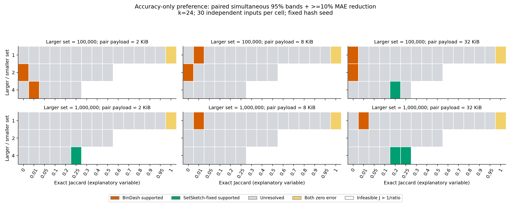
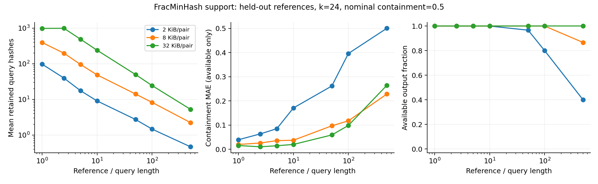

**RabbitSketch2：什么条件下考虑什么算法——精度与任务边界，2026-10-12**

**2026-10-31 更新：最新结论见[全面精度与场景选择](RabbitSketch2_comprehensive_accuracy.md)。** 七算法的完整网格和真实/下游实验已完成，共 5,016,096 条原生测量。新结果进一步区分误差优势、精度达标与下游收益，并修正了零估计造成的 containment MAE 优势解释。下文保留 10 月 12 日的阶段性证据，当前选型以新报告为准。

当前选择应由**目标指标、集合大小比例、重叠结构、有效样本数和空间预算**共同决定。本轮新增 10,800 条原生测量，并重新分析已有七算法、独立基因组和任务数据；运行时间不进入任何选择规则。

最需要修改的旧结论是：**普通 Jaccard 不能只用一个 J 阈值切换算法；containment 不能直接等同于 FracMinHash；cardinality 也不能直接等同于 HLL。** 目前有证据支持条件化的候选集合，尚未得到能覆盖所有条件的自动选择器。

**当前可用的选择依据**

| 目标和条件 | 优先考察的候选 | 证据支持到哪里 |
| --- | --- | --- |
| 普通集合 Jaccard，低重叠，固定 payload | BinDash | 原有筛选和本次部分低重叠条件均支持其等预算精度；极低 J 仍须检查相对误差、P95 和零估计率 |
| 普通 Jaccard，高重叠；或大小不等但小集合大部分被覆盖 | SetSketch-fixed，同时保留 BinDash 对照 | 独立真实数据支持高 J 的误差优势；新增不等大小条件表明优势也可能出现在 J=0.20。没有统一切换阈值 |
| Directed containment，预算固定，主要追求误差低且结果可用 | SetSketch-fixed、FracMinHash；必要时比较 HLL 或 BinDash+HLL | 本次 held-out C≈0.5 的点估计中，SetSketch-fixed 在全部七档比例下更准；FracMinHash 的使用还取决于 query 实际保留样本数 |
| 完全或接近完全包含，需要直接的阈值样本比较 | FracMinHash 是合格候选，SetSketch-fixed 也必须纳入比较 | 非空、同阈值且完全包含的 FracMinHash 样本可准确返回 1；这是机制适配，不是其独占的精度优势，不能推广到一般部分包含 |
| distinct k-mer cardinality | HLL 与 SetSketch-fixed | 相同 register payload 下误差排序随输入规模和参数变化，现有实验不足以指定唯一赢家 |
| 相对 abundance 的 **probability Jaccard** | ProbMinHash-weighted | 指标匹配且已有 profile 验证；当前只测一个 weighted 候选，不能据此宣布同类最优 |
| min/max weighted Jaccard、真实 ANI 阈值判断、聚类/近缘物种区分 | 先确认估计对象与下游误差要求，再筛选候选 | probability Jaccard 不等于 min/max Jaccard；普通 Jaccard 更准也不自动证明 alignment ANI 或下游分类更好 |

表中的 **SetSketch-fixed 均指隔离实验副本的 [partitioned-joint 修正版](benchmarks/screening/patches/setsketch_partitioned_joint.patch)**。当前生产 `src/SetSketch.cpp` 尚未包含该修正，因此这些推荐不能直接套用到未修正的生产实现。BinDash+HLL 是单独计费的组合配置，不是原生 BinDash。

**新增实验揭示的选择条件**

设较大集合与较小集合的基数比为 r≥1，小集合被覆盖的比例为 C_small。对于同一对精确集合：

`J ≤ 1/r`，并且 `C_small = J(1+r)/(1+J)`。

因此，r=4、J=0.20 对应 C_small≈0.833；r=4、J=0.25 已是小集合完全包含。不能把这两类输入与等大小、同 J 的输入当作同一种“低重叠”条件。这里的 r 是 **distinct k-mer 基数比**，不是直接用文件字节数或序列长度替代。

本次测试 k=24，较大集合基数为 10 万/100 万，r=1/2/4，15 个目标 J 值；排除 J>1/r 后有 60 个条件，每个条件 30 组独立输入。三档预算为 **A+B 两个 sketch 的查询 payload 总和** 2/8/32 KiB；这不是构建内存或进程 RSS。输入是具有精确集合真值的 canonical k-mer DNA carriers，不是新采集的真实基因组。

以下非端点条件同时满足“配对误差差的近似同时 95% 区间排除 0”和“MAE 至少降低 10%”。区间在全部 180 个条件×预算比较上控制一组比较，方法与阈值已在运行前写入[协议](benchmarks/selection_accuracy/PROTOCOL.md)。MAE 为 Jaccard fraction。

| 较大集合基数 | r | J | pair 预算 | BinDash MAE | SetSketch-fixed MAE | 本条件支持 |
| ---: | ---: | ---: | ---: | ---: | ---: | --- |
| 100,000 | 1 | 0.01 | 8 KiB | 0.001872 | 0.003795 | BinDash |
| 1,000,000 | 1 | 0.01 | 8 KiB | 0.001513 | 0.004022 | BinDash |
| 1,000,000 | 1 | 0.01 | 32 KiB | 0.000732 | 0.002070 | BinDash |
| 100,000 | 4 | 0.01 | 2 KiB | 0.002768 | 0.005729 | BinDash |
| 100,000 | 4 | 0.20 | 32 KiB | 0.003976 | 0.002073 | SetSketch-fixed |
| 1,000,000 | 4 | 0.20 | 32 KiB | 0.003784 | 0.001899 | SetSketch-fixed |
| 1,000,000 | 4 | 0.25 | 2 KiB | 0.018297 | 0.007748 | SetSketch-fixed |
| 1,000,000 | 4 | 0.25 | 32 KiB | 0.003696 | 0.001634 | SetSketch-fixed |

排除 J=0/1 控制后，156 个比较中有 **4 个支持 BinDash、4 个支持 SetSketch-fixed、148 个尚未判定稳定赢家**。这不表示其余条件等价；30 次重复及整组比较校正可能不足以识别较小差异。不能把相邻格子的点估计连接成已经证明的切换曲线，更不能把“J>0.5”写成普遍定律。完整数值、pointwise 区间和同时区间见[配对结果](benchmarks/results/selection_accuracy_20261012/new_paired_comparisons.csv)。

固定 hash seed=42，重复变化的是输入集合。结果尚未证明对所有 hash seeds、k 和序列组成成立。这是针对原有候选趋势的新数据检验，没有重复测试七个算法的全部参数。

**与已有真实数据、七算法结果如何相互支持**

已有独立验证包含 900 genomes、60 属、1,967 对比较。在 k=24、8 KiB/pair 下，BinDash/FastKMV 的 Jaccard MAE 为 0.005822/0.012034；在 J>0.5 的相同 809 对上，SetSketch-fixed/BinDash 为 0.004701/0.005757。后一个配对差的 genus-cluster pointwise 95% 区间为 [-0.001409, -0.000707]。它支持**该真实数据分层**中的优势，区间没有做所有真实数据分层的多重比较校正，也不能提供精确的转折位置。[真实数据表](benchmarks/results/selection_accuracy_20261012/real_budget_accuracy.csv)、[配对区间](benchmarks/results/selection_accuracy_20261012/real_paired_cluster_intervals.csv)。

本轮还重新纳入旧合成筛选的 KSSD，结合冻结的 SetSketch 修正和 FracMinHash 扩展，共分析 92,960 条测量、84 个条件、七个候选。在 8 KiB/pair 的 84 个条件中，最低观测 MAE 分别出现在 BinDash 41 次、SetSketch-fixed 36 次、HLL 5 次、FracMinHash/ProbMinHash-unweighted 各 1 次，FastKMV/KSSD 为 0 次。**这些只是已测、非空、预算可行配置的描述性计数，不是显著性检验或全局淘汰结论。** KSSD 的旧筛选只含 half_subk=6、dr=0–3，预算/非空覆盖分别为 56/51 个条件，不能冒充覆盖所有压缩参数。后续真实验证包含更紧凑配置，其结果单独保留。[覆盖表](benchmarks/results/selection_accuracy_20261012/frozen_seven_coverage.csv)、[逐条件七算法表](benchmarks/results/selection_accuracy_20261012/frozen_seven_budget_accuracy.csv)。

因此，暂不使用性能作为依据时，**FastKMV、KSSD 和 unweighted ProbMinHash 暂无被这些数据确立的独占推荐区**。继续保留它们作为候选和对照；不能为了让每个实现都有一个用途而补造场景。个别条件的最低点估计也不足以建立一个稳定的“最佳场景”。

**Containment：先看 query 实际留下多少信息**

重新核对的 held-out 数据按 reference 隔离，含 10 个 validation references；每个非 KSSD 配置测三个 seeds。这是已有 700 对实验的独立一半，不是本轮新增的生物数据。下表固定 k=24、8 KiB/pair、nominal C=0.5；MAE 仅在有结果的输出上计算，故必须同时报告可用率。

| reference/query 长度比 | FracMinHash 平均 query hashes | FracMinHash 可用率 | FracMinHash MAE | SetSketch-fixed MAE / 可用率 |
| ---: | ---: | ---: | ---: | ---: |
| 10 | 48.8 | 100% | 0.0371 | 0.0274 / 100% |
| 50 | 14.2 | 100% | 0.0968 | 0.0655 / 100% |
| 100 | 8.2 | 100% | 0.1175 | 0.0932 / 100% |
| 500 | 2.2 | 86.7% | 0.2282 | 0.1958 / 100% |

预算选择仅按 payload，不查看误差；变长 sketch 的 native 参数可因输入而异，不能把表理解成一个固定 scaled 的保证。对同一 ratio，改变预算或 scaled 会改变保留样本数；不能制定“ratio 大就选 FracMinHash”的规则。上表没有对 secondary containment 比较新增显著性检验，保留为点估计证据。[逐样本支撑量](benchmarks/results/selection_accuracy_20261012/fracminhash_query_support_rows.csv.gz)、[汇总](benchmarks/results/selection_accuracy_20261012/fracminhash_query_support.csv)。

接近完全包含时，FracMinHash 的样本机制很合适，但不代表它独占优势：C=1、ratio=500、8 KiB/pair 时，FracMinHash 可用率仅 83.3%；SetSketch-fixed 仍全部有结果且观测误差接近机器精度。部分包含则须重新比较：C≈0.5 时 SetSketch-fixed 在本次七档比例上的点估计均更准。C≈0.1 的部分条件，BinDash+HLL 的点估计又更低，所以 SetSketch-fixed 也不能被命名为“所有 containment 的赢家”。

原生 BinDash 在这批数据的 occupancy cardinality 饱和时没有可用的 derived containment；组合 BinDash+HLL 的两部分都计入预算。KSSD 的实验 derived containment 不属于当前 public query contract，不能作为用户可调用的推荐入口。[全部 held-out containment 表](benchmarks/results/selection_accuracy_20261012/heldout_containment_budget_accuracy.csv)。

**Cardinality 与 weighted：从指标适配到精度选择，仍需区分**

HLL/SetSketch-fixed 在 k=24、p=12、每对象 4 KiB 时的相对 MAE：10 kb 输入为 1.090%/0.976%，5 Mb 输入为 1.158%/1.331%。在 p=16、每对象 64 KiB、5 Mb 输入时又为 0.330%/0.257%。这些样本结果表明两者都应保留，不能在排除性能因素后仍宣布 HLL 是唯一默认选择。此 panel 只比较这两个算法，且 50 Mb 输入是同一 human reference 的窗口压力测试。[基数结果](benchmarks/results/selection_accuracy_20261012/cardinality_accuracy.csv)。

ProbMinHash-weighted 的 CAMI marine profile 验证在 m=2048 时 probability Jaccard MAE=0.007745、P95=0.018708。这个结论对应 abundance profile 层面及特定 estimand。不能据此推荐它估计 min/max weighted Jaccard，也不能把重复 k-mer 的次数是否保留当成一个无关开关；那会改变任务本身。[weighted 结果](benchmarks/results/selection_accuracy_20261012/weighted_accuracy.csv)、[指标审计](benchmarks/regimes/METRIC_AUDIT.md)。

**如何把这些结果用于实际选择**

1. 指定要估计的指标、误差尺度（绝对/相对、MAE/P95）、允许的无效输出比例和查询 payload 预算。
2. 用输入类型和小规模校准估计基数、大小比例、重叠区间及样本支撑量，再在相应条件下比较候选。本文的 exact J、exact C 是解释实验的变量，不能被免费提供给在线选择器。
3. 只在满足误差、预算和可用率的候选中给出建议。没有候选满足时，返回“当前预算下没有得到验证的配置”；多个候选均满足而差异未定时，保留候选集合。
4. 选择需作用于可比较的对象组或整个 workload。当前 unified API 不支持不同算法的 sketch 直接互比，不能给每个 genome 任意选择不同后端，再期望构成完整距离矩阵。
5. 面向 ANI 阈值、聚类和近缘物种区分，应在独立数据上验证下游错误率和稳定性。本轮没有新完成这些下游验证，也没有据此升级原 ANI advisor 的误差承诺。

目前能成立的研究表述是：**在已测实现和空间预算下，估计目标与重叠结构会改变候选的精度优势；已有数据支持若干条件化偏好，但切换边界仍有大面积不确定区。** 新结果特别提示把基数比和小集合覆盖比例纳入后续选择研究，而非只用全局 J 或“近缘/远缘”标签。

代码、配置、预先写定的协议和复现命令见 [selection_accuracy](benchmarks/selection_accuracy/README.md)。新增 21 项分析检查通过，涵盖缺失/重复记录、输入指纹、精确真值、预算、配对重采样及未定结果；这里报告的是分析验证，不是重新执行整个库的编译/回归测试。
