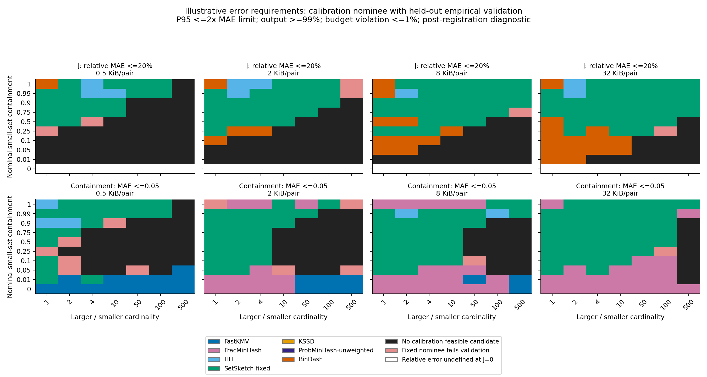
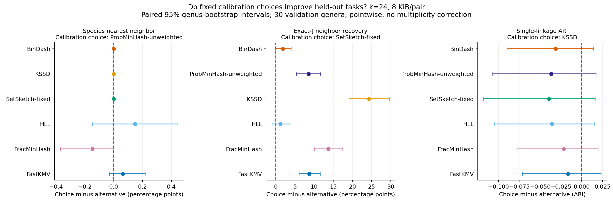

# RabbitSketch2：什么条件下选什么算法

2026-10-31，全面精度实验完成。当前证据支持**随重叠结构、预算和目标指标改变候选优先级**；尚未得到通用的切换阈值，也没有证明自动选择能够稳定改善物种识别和聚类。本轮不比较运行时间。

完整表格、13 组图及统计方法见[实验报告](benchmarks/results/comprehensive_accuracy_20261030/report.md)。下文给出可直接用于下一步研究的选型依据；[10 月 12 日指南](RabbitSketch2_accuracy_selection_guide.md)保留为历史结果。

**所有 SetSketch-fixed 结论都依赖实验副本的 [partitioned-joint 修正](benchmarks/screening/patches/setsketch_partitioned_joint.patch)。2026-11-05，当前库已合入同一估计器修正；历史实验的固定源码与结果保持原样。**

## 当前应怎样选择

这里的 r 是较大/较小集合的 distinct k-mer 基数比，C 是较小集合的真实覆盖率。它们与 J 满足 `J=C/(1+r−C)`。例如 r=10、C=0.99 时 J≈0.099；这类输入的小集合几乎完全被覆盖，不能与等大小的低重叠输入混为一谈。

| 任务和条件 | 优先比较的候选 | 本轮证据及限制 |
| --- | --- | --- |
| 普通集合 Jaccard，较低覆盖率、规模较接近 | **BinDash**，保留 SetSketch-fixed | 在 0<C≤0.1、r≤4 的 432 个合格条件×预算中，BinDash 的观测 MAE 有 419 个低于 SetSketch-fixed；这是描述性趋势，不是 419 次显著获胜 |
| 普通 Jaccard，小集合高度被覆盖，包含等大小和不等大小输入 | **SetSketch-fixed**，同时保留 HLL、BinDash | 0.9≤C<1、r≤4 时，SetSketch-fixed 的观测 MAE 在 288 个比较中的 280 个低于 BinDash；HLL 在部分条件仍有竞争力。不能只按一个 J 阈值切换 |
| 部分 containment，要求估计误差小且输出完整 | **SetSketch-fixed、HLL、FracMinHash** | 先检查所需精度能否在预算内达到；FracMinHash 尤其要检查小 query 留下多少 hashes，不能仅因集合不平衡就推荐它 |
| 完全或接近完全包含 | **FracMinHash、SetSketch-fixed** | 有足够非空样本时是合适候选；完全包含的误差很小，不等于已经证明能区分相邻覆盖率。恒报 1 对照也必须看 |
| distinct k-mer 基数 | **HLL、SetSketch-fixed** | 按规模、register 数和误差要求判断；没有由本轮确立的统一唯一赢家 |
| abundance 的 probability Jaccard | **ProbMinHash-weighted** | 指标匹配；CAMI 的 45 对 profiles、8 seeds 下，m=2048 的 MAE=0.00834、P95=0.01939。它不等于 min/max weighted Jaccard，本轮也未比较其他 weighted 后端 |
| 恢复精确 Jaccard 的最近邻 | **SetSketch-fixed、BinDash、HLL** | k=24、8 KiB/pair 的验证任务中，三者都比 FastKMV 恢复更多精确近邻；三者之间还不足以指定唯一赢家 |
| 物种区分、基因组聚类 | **暂不指定稳定赢家** | 物种识别接近天花板，聚类优势的迁移不稳定；应直接按下游任务验证，不能从 Jaccard MAE 排名直接推出 |

FastKMV、KSSD 和 unweighted ProbMinHash 的数据全部保留。这轮没有为它们确立排他的精度推荐区，也没有证明它们在所有条件、参数和任务下都被支配。尤其 KSSD 的档位较粗、实际预算利用率会变化；校准下游任务时还会选中 KSSD 或 unweighted ProbMinHash，不能把普通 Jaccard 的排序当作全局淘汰依据。

## 把“适合”变成明确的误差要求

以下固定 k=24、较大集合基数为 1,000,000。预算是 **A+B 两个 Sketch 的查询 payload 总和**，不是构建内存、完整对象内存或 RSS。每个候选还要求有效输出≥99%、预算超限≤1%；算法和预算在校准数据上选定，验证失败不会事后换人。

| 条件与要求 | 预算 | 校准选择及验证结果 |
| --- | ---: | --- |
| r=1、C=0.1；J 相对 MAE≤20%、相对 P95≤40% | 8 KiB | 校准选择 BinDash，通过；验证绝对 MAE=0.00507、P95=0.01083。还有其他达标候选，不能称唯一最优 |
| r=1、C=0.9；相同 J 要求 | 8 KiB | 校准选择 SetSketch-fixed，通过；验证绝对 MAE=0.00555、P95=0.01172。七个候选均满足该宽松要求 |
| r=100、C=0.5；相同 J 要求 | 8 KiB | 未找到校准合格配置 |
| r=50、C=0.5；containment MAE≤0.05、P95≤0.10 | 8 KiB | 未找到校准合格配置 |
| 同一 containment 条件和要求 | 32 KiB | 校准选择 SetSketch-fixed，通过；验证 MAE=0.02640、P95=0.06709，验证达标集合也只有它 |
| r=500、C=0.05；containment 相对 MAE≤20%、相对 P95≤40% | 8 KiB | 未找到校准合格配置；不能把大多数零估计当成满足相对精度要求 |

黑色表示校准数据中没有合格配置，红色表示固定候选在验证中失败。其他颜色仅表示校准候选通过验证，**不是显著优于全部竞争者**。图中的 containment 采用绝对误差要求，低 C 处仍须查看零估计诊断。

这些误差档位是在初步结果后增加并明确记录的[诊断分析](benchmarks/comprehensive_accuracy/ANALYSIS_ADDENDUM.md)，不是原始确认性假设或误差保证。完整 [50,400 行约束结果](benchmarks/results/comprehensive_accuracy_20261030/synthetic_constraint_profiles.csv.gz)同时保留 1,136 个固定候选验证失败记录。“没有合格配置”只适用于本次参数网格和要求。

## 真实数据是否支持这种变化

900 个基因组按属分为 30 个校准属和 30 个验证属；自然比较扩展为 6,426 对。在 k=24、8 KiB/pair 下：

| 验证分层 | BinDash Jaccard MAE | SetSketch-fixed MAE | HLL MAE |
| --- | ---: | ---: | ---: |
| 全部属内比较，3,150 对 | 0.003445 | 0.003886 | 0.007045 |
| J≥0.5，486 对 | 0.006343 | 0.005205 | 0.007090 |

BinDash−SetSketch-fixed 的属均值误差差，在全部属内比较中的 pointwise 95% 配对区间为 **[−0.000705, −0.000178]**；高 J 分层为 **[0.000602, 0.001635]**。方向确实改变。区间以属为单位，未作跨分层多重校正；高 J 分层中各属的样本数不同，属均值差不等于上表 pair-pooled MAE 的直接相减。

真实序列 containment 也不能由任务名称决定算法：名义 C=0.5、长度比 100、8 KiB/pair 时，SetSketch-fixed 的 MAE=0.09319、HLL=0.11941、FracMinHash=0.27668；FracMinHash 的可用率仅 96.7%。这些 MAE 是有输出样本上的误差，必须同时读可用率。这里的**序列长度比**不能直接替代前面合成实验的精确 k-mer 基数比。

## 哪些下游收益成立，哪些还不能写

任务是每个已知属内 15 个基因组、3 个 species taxids 的受控近邻识别和聚类。并列近邻按均匀打破并列的期望计分，聚类阈值只在校准属上选择。

| k=24、8 KiB/pair，30 个验证属 | FastKMV | BinDash | HLL | SetSketch-fixed |
| --- | ---: | ---: | ---: | ---: |
| 精确 J 近邻恢复率 | 77.96% | 84.79% | 85.44% | 86.67% |
| 物种近邻识别准确率 | 99.49% | 99.56% | 99.41% | 99.56% |
| single-linkage ARI | 0.87631 | 0.89141 | 0.89587 | 0.89940 |

SetSketch-fixed 相比 FastKMV 的近邻恢复率提高 **8.70 个百分点**，pointwise 95% 配对区间为 **[6.08, 11.56]**。相对 BinDash、HLL 的区间均跨零；因此，可以写“恢复精确近邻的能力改善”，不能写成它已经是唯一最优的近邻算法。

物种识别没有得到清楚的提升；SetSketch-fixed 相比 FastKMV 的 ARI 差区间也包含零。更直接的迁移反例是：k=24、8 KiB 时，校准组按 ARI 选中 KSSD，校准 ARI=0.91419，验证为 0.85995；它没有保持校准时的领先。这个失败未被改选验证赢家掩盖。

目前不能声称自动选型已稳定改善基因组聚类和近缘物种区分，也不能把此处的已知属内任务外推为开放数据库的未知物种识别。Exact-J 的聚类也是对分类标签的一个参照；Sketch 的某个 ARI 点值更高，并不说明压缩表示掌握了更多精确集合信息。

## 边界为什么会变化

首先，重叠结构需要 r 和 C 一起描述。由 `J=C/(1+r−C)` 可直接看出，大 r 会使 J 很小；小的绝对 J 误差可能对应很大的相对误差。本轮 FastKMV 有 157 个非端点 containment MAE 胜出条件，**全部至少 90% 输出为零，全部未优于恒报零的 MAE**。这些不是可靠估计微弱包含的推荐区。

其次，相同查询 payload 下保存的信息不同。8 KiB/pair 对应 FastKMV 每对象 512 个 64-bit hashes、BinDash 2,048 个 16-bit signatures，HLL/SetSketch 每对象 4,096 个 8-bit registers。原生编码和估计器都影响误差；HLL 和 SetSketch 使用的联合估计路径也不同。它们与观察到的偏好变化相符，但本轮没有将编码、采样和估计器的贡献逐项隔离，不能把机制推断写成已证明的唯一原因。

第三，阈值采样要看 **query 的有效样本数**。本次 k=24、较大基数 100 万、C=0.5、8 KiB 条件下，FracMinHash 在 r=1 时平均保留 411.7 个 query hashes；r=500 时只有 1.42 个，空样本率为 31.25%。这直接解释了为什么“支持 containment”与“在该预算下精确估计 containment”是两件事。BinDash 原生基数估计在 occupancy 饱和后不可用；本轮没有把无限基数或不可用 containment 算成零误差。

最后，ANI 的模型误差不能由选择 Sketch 消除。在混合 substitution/indel 的 160 对验证样本上，**精确 J** 换算为 alignment-column identity 已有 MAE=0.00481，即约 0.481 个百分点。相同 8 KiB 条件下，BinDash/SetSketch-fixed 的 ANI sampling MAE 为 0.00121/0.00130，而相对列一致率的总 MAE 为 0.00517/0.00514。两种误差的参照不同，不能相加；自然基因组部分也没有新生成 alignment ANI 真值。

## 覆盖、检验与复现

本轮完整执行并核验了 **5,016,096 条原生配置/输入对测量**，另有 20,298 条 exact pair 结果。它们不是五百万个独立生物样本。

| 面板 | 覆盖 |
| --- | --- |
| 七算法合成网格 | 4 个 k × 3 档较大基数 × 7 档比例 × 10 档覆盖率；128 组输入/名义条件；8 个均衡 hash seeds；0.5/2/8/32 KiB |
| 合成独立输入 | 107,520 对；840 个名义条件，整数交集取整后有 832 个不同真值条件；每条件 64 校准、64 验证 |
| 自然基因组 | 既有 900 genomes、180 species、60 属；6,426 对；k=20/24/32；非 KSSD 三个 seeds |
| 受控与带权 | 320 对 substitution/indel、700 对 containment、765 对 abundance/profile；weighted 单独含更大的 128 KiB 档位 |
| 下游 | 30 属校准、30 属验证；近邻物种识别、精确近邻恢复、聚类 ARI |

统计上的唯一赢家要求在同一条件/指标内，跨预算和算法的配对同时区间排除零，并且 MAE 至少改善 10% 和 0.0001；没有对全网格一次性校正。实测候选图保留大量未定条件，不将其解释为等价。真实及下游区间是 pointwise 的属/参考序列聚类重采样结果。

完成校验包括 **517 个输出归档的哈希、逐输入重算合成 MAE/P95、21 项分析测试全部通过**。参见[验证记录](benchmarks/results/comprehensive_accuracy_20261030/verification.json)、[发布清单](benchmarks/results/comprehensive_accuracy_20261030/publication_manifest.json)和[复现工作流](benchmarks/comprehensive_accuracy/README.md)。精简证据约 32 MB；完整原生输出、逐输入表及输入库存保留在外部实验目录。

本轮扩充了既有真实数据的比较和参数覆盖，没有新采集 900 个基因组；也不覆盖蛋白质、reads 深度/错误率或所有可能参数。图中的真实 J/C 用来解释适用条件，不是在线免费可知的特征。后续选择策略仍须从任务先验或可观测信息中推断条件，并在新的数据域检验迁移。
