# RabbitSketch2 全面精度实验与场景选择

完整实验已完成。实验协议登记于 2026-10-30，2026-10-31 恢复执行；本轮没有进行性能比较。现在应把三个问题分开：**谁的误差显著更低、谁满足实际精度要求、谁改善了下游任务**。它们不能相互替代。

## 1. 覆盖范围与“全面”的边界

| 部分 | 本次覆盖 |
| --- | --- |
| 统一算法 | FastKMV、FracMinHash、HLL、SetSketch-fixed、KSSD、unweighted ProbMinHash、BinDash；weighted ProbMinHash 单独评测 |
| 合成输入 | k=20/24/28/32；较大基数 10⁴/10⁵/10⁶；比例 1/2/4/10/50/100/500；10 档小集合覆盖率；128 组独立输入/条件 |
| 参数与预算 | 0.5/2/8/32 KiB 的 A+B 查询 payload；8 个均衡 hash seeds，KSSD 的 reduction table 不随 seed 改变 |
| 合成测量 | 840 个名义条件、832 个不同的整数真值条件，107,520 组独立输入，3,118,080 条配置测量 |
| 真实与任务 | 900 genomes、180 species、60 属的 6,426 对比较；320 对混合突变；700 对修正后的 containment；765 对 weighted profiles/合成丰度 |
| 真实配置 | 505 个 native/exact 批次；自然基因组 k=20/24/32，混合突变与 containment k=24 |
| 下游 | 物种近邻识别、精确 J 近邻恢复、single-linkage 聚类 ARI；30 属校准、30 属验证 |

真实部分复用了原来的基因组和受控输入库存，新增的是比较与配置覆盖，**不是新采集了 900 个独立样本**。本轮也没有覆盖蛋白质、测序 reads 的深度/错误率或全部 k 值；Legacy MinHash、OrderMinHash 不在本轮比较范围。所有空间数值均为查询 payload，不代表构建内存或 RSS。

SetSketch-fixed 始终指隔离工作副本中的 partitioned-joint 修正版。生产源文件没有随本轮实验替换。结论对应这个被测实现，不能直接套用于未修正的生产 SetSketch，也不能概括所有同名算法的实现。

## 2. 选择必须带上误差要求

下面是从完整结果中抽取的操作条件示例：k=24、较大集合基数 1,000,000；r 是基数比，C 是小集合真实覆盖率。每项还要求有效输出 ≥99%、预算超限 ≤1%。表中的候选先由校准数据选择，再保留验证结果；失败不会换成验证集上的赢家。

| metric | requirement | ratio | C | pair_KiB | calibration_nominee | validation | validation_MAE | validation_candidates |
| --- | --- | --- | --- | --- | --- | --- | --- | --- |
| j_error | relative MAE≤0.2; P95≤2×limit | 1 | 0.1 | 8 | BinDash | pass | 0.0050723 | BinDash; FracMinHash; KSSD; FastKMV; SetSketch-fixed |
| j_error | relative MAE≤0.2; P95≤2×limit | 1 | 0.9 | 8 | SetSketch-fixed | pass | 0.0055487 | BinDash; FracMinHash; HLL; KSSD; FastKMV; ProbMinHash-unweighted; SetSketch-fixed |
| j_error | relative MAE≤0.2; P95≤2×limit | 100 | 0.5 | 8 | 无校准候选 | no_calibration_candidate | — | 无 |
| c_error | absolute MAE≤0.05; P95≤2×limit | 50 | 0.5 | 8 | 无校准候选 | no_calibration_candidate | — | 无 |
| c_error | absolute MAE≤0.05; P95≤2×limit | 50 | 0.5 | 32 | SetSketch-fixed | pass | 0.026401 | SetSketch-fixed |
| c_error | relative MAE≤0.2; P95≤2×limit | 500 | 0.05 | 8 | 无校准候选 | no_calibration_candidate | — | 无 |
| card_relative_error | absolute MAE≤0.02; P95≤2×limit | 1 | 0.5 | 8 | SetSketch-fixed | pass | 0.011172 | HLL; SetSketch-fixed |

这些绝对/相对误差要求是明确标注的**分析后诊断**，见 [ANALYSIS_ADDENDUM.md](../../../benchmarks/comprehensive_accuracy/ANALYSIS_ADDENDUM.md)。它们是可供实验设计使用的经验约束，不是置信保证，也不是经过独立新数据验证的自动选型系统。`no_calibration_candidate` 只表示本次参数和预算下未找到校准合格配置，不证明所有实现都不可能达标。

全部 50,400 个条件×预算×指标要求记录见 [synthetic_constraint_profiles.csv](synthetic_constraint_profiles.csv.gz)。其中相对误差在真值为零时标为不适用。若多个配置满足要求，就保留候选集合；没有合格候选时，应增加预算或改变误差要求，不能强行返回一个算法。

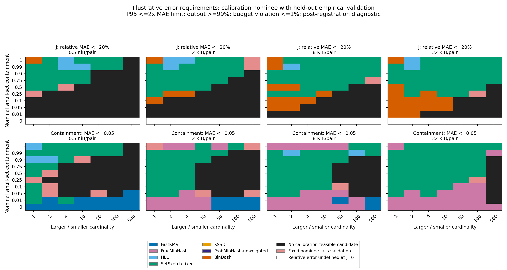

这里的颜色表示校准时选中的候选在验证数据上也满足要求，并不表示它在统计上优于所有其他合格算法；黑色表示校准中没有合格配置，红色保留固定候选的验证失败。小 C 下通过宽松的绝对误差要求仍可能来自零估计，不能据此解释为能分辨微弱包含；第 4 节给出该诊断。

## 3. 误差优势随覆盖结构变化，不能只按全局 J 划线

对 r≥1，`J=C/(1+r-C)`。相同 J 在不同 r 下意味着不同的小集合覆盖比例；例如 r=4、J=0.2 对应 C≈0.833。选择条件同时包括规模、比例、重叠结构、预算和目标 metric。

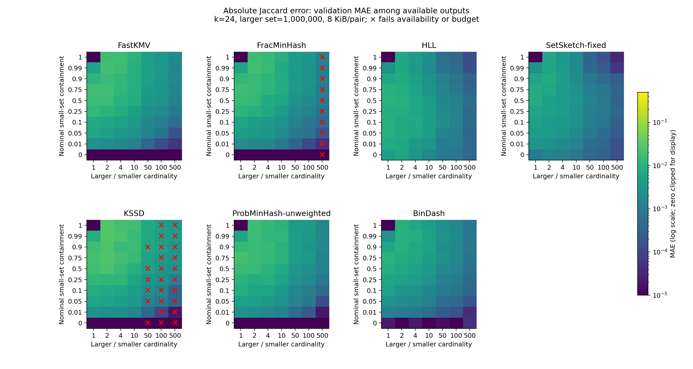

图中颜色是验证 MAE；红色 × 表示该条件不满足有效率或预算要求。它与下面的统计候选图回答不同问题：误差最低的点估计不一定是已经证实的赢家。

将完整网格按覆盖结构归纳，可以看到 BinDash 与 SetSketch-fixed 的偏好发生变化；高覆盖率时 HLL 也应保留比较。下表仅包含两端都满足输出/预算要求的条件，使用全部 4 个 k、3 档基数和 4 档预算；`left_lower_MAE` 是观测 MAE 较低的条件数，**不是显著获胜数**，也没有跨条件置信保证。比例为左/右的逐条件 MAE 比值中位数。

| condition | left | right | matched_cells | left_lower_MAE | median_MAE_ratio |
| --- | --- | --- | --- | --- | --- |
| 0<C≤0.1, r≤4 | BinDash | SetSketch-fixed | 432 | 419 | 0.6812 |
| 0<C≤0.1, r≤4 | SetSketch-fixed | HLL | 432 | 432 | 0.46876 |
| 0.9≤C<1, r≤4 | BinDash | SetSketch-fixed | 288 | 8 | 1.5081 |
| 0.9≤C<1, r≤4 | SetSketch-fixed | HLL | 288 | 223 | 0.87779 |
| 0.9≤C<1, r>4 | BinDash | SetSketch-fixed | 368 | 0 | 3.748 |
| 0.9≤C<1, r>4 | SetSketch-fixed | HLL | 368 | 324 | 0.71695 |

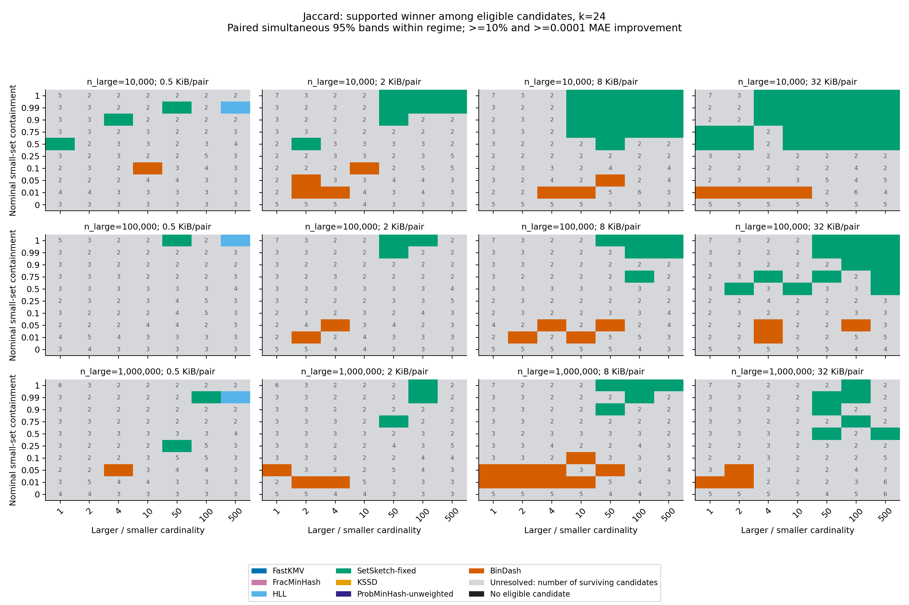

唯一赢家要求优于所有合格竞争者，配对同时 95% 区间排除零，并且 MAE 至少改善 10% 和 0.0001。区间在**同一个条件、同一个指标的所有预算和算法比较**内校正，没有把全网格当作一次整体显著性检验。灰色数字是仍未被排除的候选数，不能读成“算法等价”。

以下计数排除 C=0/1 端点，仅描述这张注册网格，不是算法全局胜率：

| metric | BinDash | FracMinHash | HLL | FastKMV | SetSketch-fixed | 尚未确定唯一赢家 |
| --- | --- | --- | --- | --- | --- | --- |
| c_error | 49 | 28 | 50 | 157 | 603 | 1769 |
| card_relative_error | 0 | 0 | 91 | 0 | 4 | 2561 |
| j_error | 139 | 0 | 12 | 0 | 263 | 2242 |

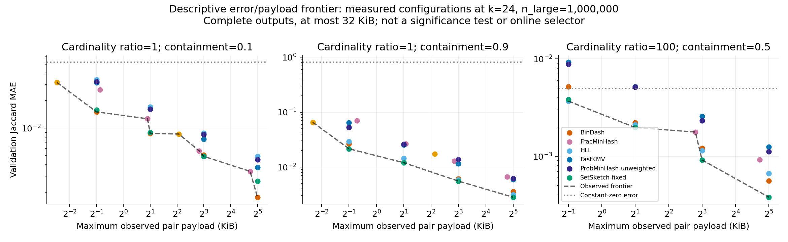

这条 front 只连接已测配置的非支配点，使用验证 MAE 与最大观测 payload，没有统计支配保证，也不包含运行时间。最低校准可行预算另见 [synthetic_minimum_calibrated_budget.csv](synthetic_minimum_calibrated_budget.csv)，验证失败不会事后改选预算。

[synthetic_repeatability.csv](synthetic_repeatability.csv) 进一步列出每个覆盖率/比例/预算条件下，优势是否跨 4 个 k 与 3 档规模复现。没有用一条平滑曲线掩盖反转或未定条件。

## 4. 一个重要修正：低 MAE 有时只是“几乎总报零”

非端点的 FastKMV containment MAE 胜出条件共有 157 个，其中 157 个的零估计率至少 90%，157 个的观测 MAE 未优于恒为零的诊断基线。**这些条件不能据此推荐为精确估计微弱包含的优势场景。** 原始显著性结果没有被删去，同时提供 [winner diagnostics](synthetic_winner_diagnostics.csv) 和恒零/恒一对照。

恒一对照同样保留：在完全或接近完全包含的条件中表现好，也不自动证明能够分辨相邻覆盖率。这些常数只用于诊断误差目标，不是利用真值替用户选择一个预测器。

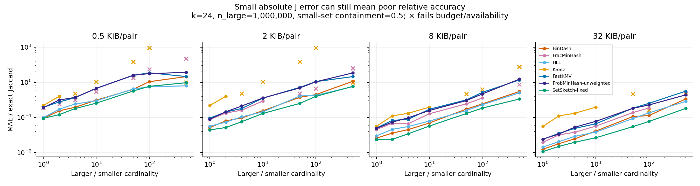

高不平衡会令 J 很小；绝对误差看起来很小，相对误差仍可能接近或超过 100%。需要区分“相似度很低时绝对误差受控”和“能可靠识别弱重叠”。这也是旧结论不够清楚的重要原因，不能靠增加样本量解决指标本身的歧义。

## 5. Containment 与 cardinality 需要独立判断

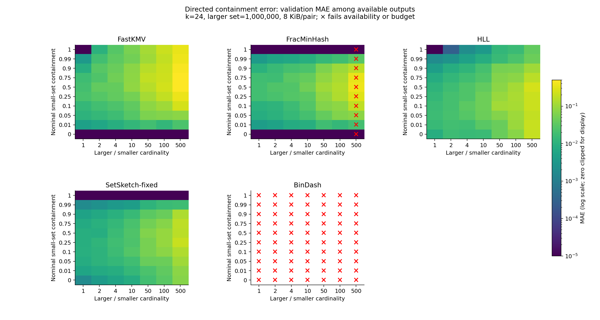

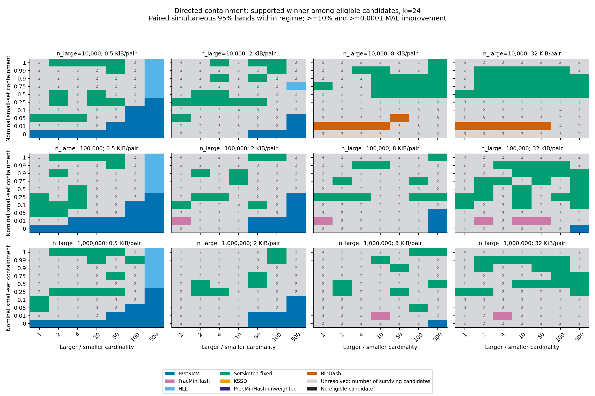

阈值采样的关键限制在小 query 的有效样本数。下表固定 k=24、较大基数 1,000,000、C=0.5、8 KiB/pair，使用注册的 FracMinHash scaled 规则；误差是有结果样本上的 MAE，必须同时读空样本率。

| size_ratio | mean_query_hashes | min_query_hashes | empty_fraction | mae_c |
| --- | --- | --- | --- | --- |
| 1 | 411.7 | 377 | 0 | 0.01875 |
| 2 | 276.7 | 222 | 0 | 0.025846 |
| 4 | 163.19 | 135 | 0 | 0.026581 |
| 10 | 72.812 | 53 | 0 | 0.047701 |
| 50 | 16.375 | 10 | 0 | 0.10622 |
| 100 | 8.8281 | 4 | 0 | 0.14121 |
| 500 | 1.4219 | 0 | 0.3125 | 0.37727 |

因此“大小不平衡就选 FracMinHash”不成立。SetSketch-fixed、FracMinHash、HLL，以及在某些条件尚未饱和的 BinDash，都需按误差目标和输出有效性比较。KSSD 的 cardinality/containment 仅作为诊断，当前 public query contract 不支持，未列入推荐候选。原生 BinDash cardinality 饱和时相关指标也标为不可用。

基数比较同时保留 [per-object cardinality](synthetic_object_cardinality.csv)；主表的 cardinality error 是同一独立输入对中两个对象相对误差的平均。不同规模、参数的 HLL/SetSketch 排序不能用一个笼统默认值覆盖。KSSD 的稀疏档位和 FracMinHash 的余量会影响预算利用率；表中记录实际字节，不能把档位粗或利用率低的结果解释成算法原理上的必然劣势。

合成网格的 FracMinHash scaled 根据已知的设计基数设置，只用于控制实验预算；它不证明已经实现了面向未知输入的自动基数预测或资源规划。真实数据的可变参数则由校准组确定并固定，验证超限照实计入失败。

## 6. 真实数据与下游结果

以下是 k=24、8 KiB/pair、验证属的真实 Jaccard 结果。固定参数在校准属上确定；若某算法缺行，应查 [coverage](real_coverage.csv)，不能将缺失视为零误差或直接宣布淘汰。

| stratum | algorithm | parameter | mae | p95 | availability | mean_pair_bytes | budget_violation_fraction |
| --- | --- | --- | --- | --- | --- | --- | --- |
| J_05_1 | BinDash | 2048 | 0.0063429 | 0.019425 | 1 | 8192 | 0 |
| within_genus | BinDash | 2048 | 0.0034448 | 0.013221 | 1 | 8192 | 0 |
| J_05_1 | FracMinHash | 20000 | 0.021606 | 0.063645 | 1 | 2865.8 | 0 |
| within_genus | FracMinHash | 20000 | 0.01004 | 0.041487 | 1 | 3081.6 | 0 |
| J_05_1 | HLL | 12 | 0.0070902 | 0.021033 | 1 | 8192 | 0 |
| within_genus | HLL | 12 | 0.0070452 | 0.020055 | 1 | 8192 | 0 |
| J_05_1 | KSSD | 4 | 0.04378 | 0.13313 | 1 | 428.91 | 0 |
| within_genus | KSSD | 4 | 0.020835 | 0.09223 | 1 | 469.99 | 0 |
| J_05_1 | FastKMV | 512 | 0.012751 | 0.036467 | 1 | 8192 | 0 |
| within_genus | FastKMV | 512 | 0.0069439 | 0.027147 | 1 | 8192 | 0 |
| J_05_1 | ProbMinHash-unweighted | 512 | 0.01325 | 0.040016 | 1 | 8192 | 0 |
| within_genus | ProbMinHash-unweighted | 512 | 0.0070056 | 0.028175 | 1 | 8192 | 0 |
| J_05_1 | SetSketch-fixed | 12 | 0.0052051 | 0.015079 | 1 | 8192 | 0 |
| within_genus | SetSketch-fixed | 12 | 0.0038858 | 0.011703 | 1 | 8192 | 0 |

下面是对应的配对属级比较，差值为 left−right，负值表示左侧误差较低。先在每对基因组内平均 seed，再对各属平均，所以高 J 分层的属均值差不必等于上表 pair-pooled MAE 之差；区间为 pointwise 95%，没有跨分层多重校正。

| stratum | left | right | clusters | common_pairs | cluster_macro_difference | ci_low | ci_high |
| --- | --- | --- | --- | --- | --- | --- | --- |
| J_05_1 | BinDash | SetSketch-fixed | 30 | 486 | 0.0011134 | 0.00060154 | 0.0016349 |
| J_05_1 | HLL | SetSketch-fixed | 30 | 486 | 0.0019838 | 0.0012936 | 0.0026904 |
| within_genus | BinDash | SetSketch-fixed | 30 | 3150 | -0.00044101 | -0.0007053 | -0.00017802 |
| within_genus | HLL | SetSketch-fixed | 30 | 3150 | 0.0031594 | 0.0028126 | 0.0035291 |

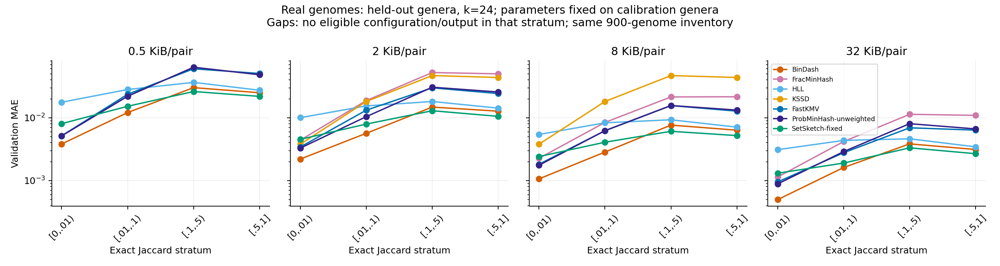

下游使用每属 15 个基因组、3 个 species taxids；近邻并列按均匀打破并列的期望给分。聚类阈值只在校准属上选择。Exact sets 是相同任务的参照，不是物种定义的绝对真理。下面仍是 k=24、8 KiB/pair，区间按属重采样，是 pointwise 区间，未做多重比较校正。

这是已知属内候选库的受控任务，不能直接外推为跨整个数据库的未知物种识别或发现能力。

| algorithm | metric | mean | valid_genera | ci_low | ci_high |
| --- | --- | --- | --- | --- | --- |
| BinDash | species_accuracy | 0.99556 | 30 | 0.98889 | 1 |
| BinDash | exact_neighbor_recovery | 0.8479 | 30 | 0.81525 | 0.87858 |
| BinDash | ari | 0.89141 | 30 | 0.83584 | 0.93976 |
| Exact sets | species_accuracy | 0.99556 | 30 | 0.98889 | 1 |
| Exact sets | exact_neighbor_recovery | 1 | 30 | 1 | 1 |
| Exact sets | ari | 0.88053 | 30 | 0.81609 | 0.93612 |
| FracMinHash | species_accuracy | 0.99704 | 30 | 0.99259 | 1 |
| FracMinHash | exact_neighbor_recovery | 0.72938 | 30 | 0.68302 | 0.77302 |
| FracMinHash | ari | 0.88155 | 30 | 0.82443 | 0.93258 |
| HLL | species_accuracy | 0.99407 | 30 | 0.98815 | 0.99852 |
| HLL | exact_neighbor_recovery | 0.85444 | 30 | 0.82123 | 0.88494 |
| HLL | ari | 0.89587 | 30 | 0.84261 | 0.94178 |
| KSSD | species_accuracy | 0.99556 | 30 | 0.98889 | 1 |
| KSSD | exact_neighbor_recovery | 0.6237 | 30 | 0.56407 | 0.68444 |
| KSSD | ari | 0.85995 | 30 | 0.77354 | 0.93278 |
| FastKMV | species_accuracy | 0.99492 | 30 | 0.98847 | 1 |
| FastKMV | exact_neighbor_recovery | 0.77964 | 30 | 0.73608 | 0.81935 |
| FastKMV | ari | 0.87631 | 30 | 0.81513 | 0.93214 |
| ProbMinHash-unweighted | species_accuracy | 0.99556 | 30 | 0.98889 | 1 |
| ProbMinHash-unweighted | exact_neighbor_recovery | 0.7813 | 30 | 0.74179 | 0.81883 |
| ProbMinHash-unweighted | ari | 0.89666 | 30 | 0.84339 | 0.94226 |
| SetSketch-fixed | species_accuracy | 0.99556 | 30 | 0.98889 | 1 |
| SetSketch-fixed | exact_neighbor_recovery | 0.86667 | 30 | 0.83605 | 0.89568 |
| SetSketch-fixed | ari | 0.8994 | 30 | 0.84548 | 0.94571 |

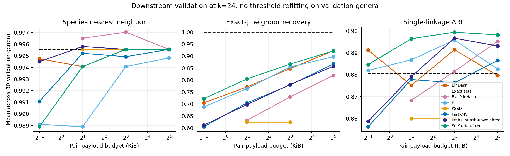

[downstream_calibrated_choices.csv](downstream_calibrated_choices.csv) 给出每个任务在校准组选择的固定算法及验证结果；[配对区间](downstream_paired_intervals.csv) 用相同验证属比较候选。需要以实际差异及区间判断是否改善下游；不能把更低的 Jaccard MAE、候选图中的赢家或事后 oracle 的优势直接写成自动选择框架的收益。本轮没有训练按每个 genome 任意切换后端的 selector；不同后端的 sketch 目前不能直接互比。

以下为 k=24 的固定任务选择。它们由校准属确定，即使验证中另一个算法更高也不替换。应结合候选间的配对区间，而非把每行最高点估计理解成确定的任务优势。

| budget | metric | algorithm | calibration_mean | validation_mean | validation_valid_genera |
| --- | --- | --- | --- | --- | --- |
| 512 | ari | BinDash | 0.89771 | 0.8912 | 30 |
| 512 | exact_neighbor_recovery | SetSketch-fixed | 0.72179 | 0.72185 | 30 |
| 512 | species_accuracy | BinDash | 0.98791 | 0.99474 | 30 |
| 2048 | ari | KSSD | 0.91419 | 0.85995 | 30 |
| 2048 | exact_neighbor_recovery | SetSketch-fixed | 0.81698 | 0.80457 | 30 |
| 2048 | species_accuracy | ProbMinHash-unweighted | 0.98874 | 0.9958 | 30 |
| 8192 | ari | KSSD | 0.91419 | 0.85995 | 30 |
| 8192 | exact_neighbor_recovery | SetSketch-fixed | 0.8763 | 0.86667 | 30 |
| 8192 | species_accuracy | ProbMinHash-unweighted | 0.98993 | 0.99556 | 30 |
| 32768 | ari | ProbMinHash-unweighted | 0.90364 | 0.89312 | 30 |
| 32768 | exact_neighbor_recovery | SetSketch-fixed | 0.92852 | 0.92148 | 30 |
| 32768 | species_accuracy | KSSD | 0.99111 | 0.99506 | 27 |

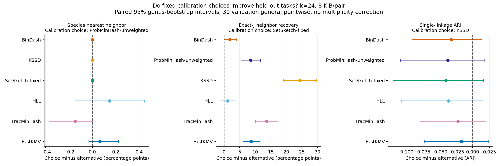

这张图比较的是各任务校准时已选定的算法与其他候选的验证差异；右侧才表示校准选择更好。物种识别已接近本任务的天花板，不能用纵轴放大的均值折线夸大收益。近邻恢复的改善也不能替代物种区分和聚类的改善证据。特别是 k=24、2/8 KiB 下校准选出的 KSSD，聚类 ARI 的验证均值未保持校准时的优势；这类迁移失败必须保留。

真实序列上的受控 containment 单独检查了上述规律。这里的 ratio 是设计的序列长度比，误差真值始终来自精确 k-mer 集合；不能将它与合成表中的精确基数比混用。下面展示两个中等覆盖率条件，全部条件仍保存在 [real_budget_accuracy.csv](real_budget_accuracy.csv.gz)。

| stratum | budget | algorithm | mae | p95 | availability | budget_violation_fraction |
| --- | --- | --- | --- | --- | --- | --- |
| ratio100_containment0.5 | 8192 | BinDash | — | — | 0 | 0 |
| ratio10_containment0.5 | 8192 | BinDash | — | — | 0 | 0 |
| ratio100_containment0.5 | 8192 | FracMinHash | 0.27668 | 0.50348 | 0.96667 | 0 |
| ratio10_containment0.5 | 8192 | FracMinHash | 0.083377 | 0.18838 | 1 | 0 |
| ratio100_containment0.5 | 8192 | HLL | 0.11941 | 0.25965 | 1 | 0 |
| ratio10_containment0.5 | 8192 | HLL | 0.038451 | 0.084779 | 1 | 0 |
| ratio100_containment0.5 | 8192 | FastKMV | 0.18346 | 0.43554 | 1 | 0 |
| ratio10_containment0.5 | 8192 | FastKMV | 0.05721 | 0.12731 | 1 | 0 |
| ratio100_containment0.5 | 8192 | SetSketch-fixed | 0.093191 | 0.23347 | 1 | 0 |
| ratio10_containment0.5 | 8192 | SetSketch-fixed | 0.027415 | 0.065318 | 1 | 0 |
| ratio100_containment0.5 | 32768 | BinDash | — | — | 0 | 0 |
| ratio10_containment0.5 | 32768 | BinDash | — | — | 0 | 0 |
| ratio100_containment0.5 | 32768 | FracMinHash | 0.10962 | 0.26757 | 1 | 0 |
| ratio10_containment0.5 | 32768 | FracMinHash | 0.032881 | 0.062584 | 1 | 0 |
| ratio100_containment0.5 | 32768 | HLL | 0.053027 | 0.15443 | 1 | 0 |
| ratio10_containment0.5 | 32768 | HLL | 0.019052 | 0.045384 | 1 | 0 |
| ratio100_containment0.5 | 32768 | FastKMV | 0.1401 | 0.28682 | 1 | 0 |
| ratio10_containment0.5 | 32768 | FastKMV | 0.029698 | 0.07595 | 1 | 0 |
| ratio100_containment0.5 | 32768 | SetSketch-fixed | 0.041951 | 0.087088 | 1 | 0 |
| ratio10_containment0.5 | 32768 | SetSketch-fixed | 0.013601 | 0.028852 | 1 | 0 |

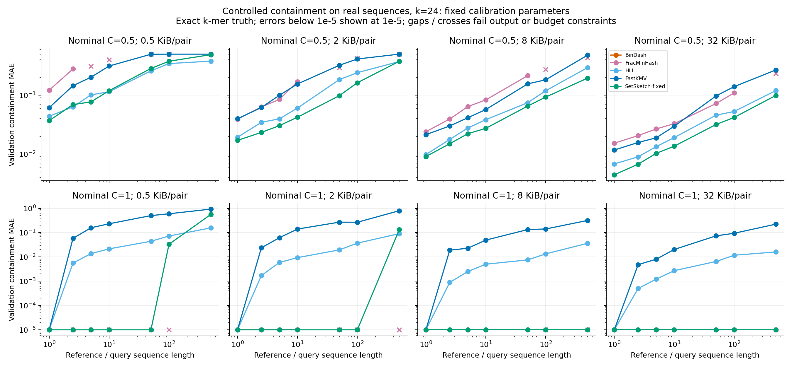

## 7. 带权与 ANI 的边界

Weighted ProbMinHash 单独估计 probability Jaccard。CAMI profile 的结果如下；它不等于 min/max weighted Jaccard，也没有另一个 weighted 候选来支持“同类最优”的结论。

| parameter | pair_payload | pairs | seeds | mae | p95 |
| --- | --- | --- | --- | --- | --- |
| 32 | 512 | 45 | 8 | 0.057225 | 0.13689 |
| 128 | 2048 | 45 | 8 | 0.03171 | 0.075972 |
| 512 | 8192 | 45 | 8 | 0.016354 | 0.041516 |
| 2048 | 32768 | 45 | 8 | 0.0083407 | 0.019391 |
| 8192 | 131072 | 45 | 8 | 0.0033908 | 0.0084539 |

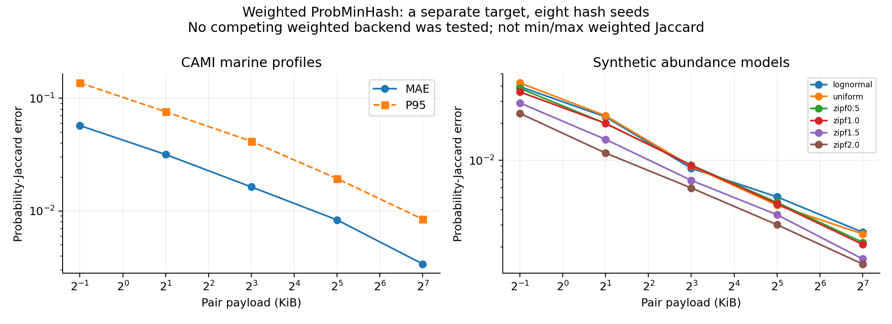

混合突变表另存 Jaccard sampling error、ANI sampling error、alignment-column identity 的总误差与 exact-J 模型残差。它们不能混成一种误差，绝对 MAE 也不能相加。真实自然基因组的分类标签是 species taxid，本轮没有新生成 alignment ANI 真值或升级旧 ANI advisor 的误差承诺。

下表是 160 对验证参考衍生样本、k=24、8 KiB/pair 的结果；精确 J 换算到 alignment-column identity 的模型残差 MAE 为 **0.00481025**。sampling error 以 exact-J 换算值为参照；column error 以已知编辑轨迹的列一致率为参照。

| algorithm | metric | mae | p95 | availability | budget_violation_fraction |
| --- | --- | --- | --- | --- | --- |
| BinDash | ani_sampling_error | 0.00121 | 0.0040514 | 1 | 0 |
| FracMinHash | ani_sampling_error | 0.0026232 | 0.0082902 | 1 | 0 |
| HLL | ani_sampling_error | 0.002415 | 0.010582 | 1 | 0 |
| KSSD | ani_sampling_error | 0.0048785 | 0.014107 | 1 | 0 |
| FastKMV | ani_sampling_error | 0.0024341 | 0.0083024 | 1 | 0 |
| ProbMinHash-unweighted | ani_sampling_error | 0.0023343 | 0.0082152 | 1 | 0 |
| SetSketch-fixed | ani_sampling_error | 0.0012959 | 0.0047419 | 1 | 0 |
| BinDash | column_ani_error | 0.0051661 | 0.020848 | 1 | 0 |
| FracMinHash | column_ani_error | 0.0056597 | 0.018124 | 1 | 0 |
| HLL | column_ani_error | 0.0058597 | 0.021538 | 1 | 0 |
| KSSD | column_ani_error | 0.0066813 | 0.023296 | 1 | 0 |
| FastKMV | column_ani_error | 0.0055597 | 0.018959 | 1 | 0 |
| ProbMinHash-unweighted | column_ani_error | 0.0055614 | 0.018959 | 1 | 0 |
| SetSketch-fixed | column_ani_error | 0.0051386 | 0.020222 | 1 | 0 |

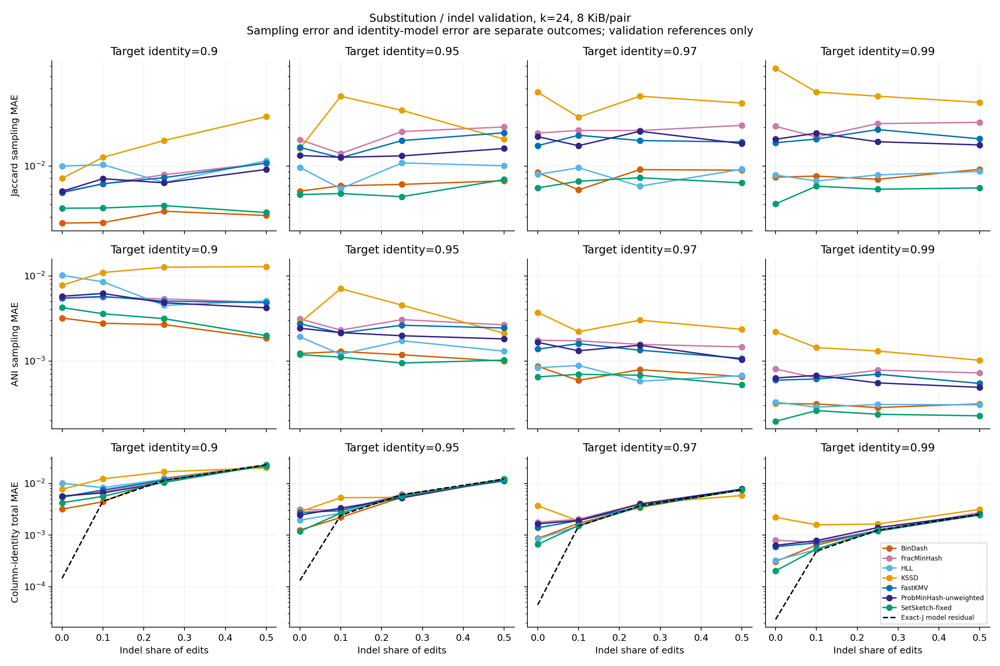

## 8. 数据与复现

完整原生数据、输入和代码指纹位于外部实验工作区；本目录发布紧凑汇总、逐条件比较和图表。校准/验证失败、空样本、预算不足、参数未覆盖及不支持的指标均保留。验证和发布清单见 [verification.json](verification.json)、[publication_manifest.json](publication_manifest.json)。运行方式见 [workflow README](../../../benchmarks/comprehensive_accuracy/README.md)。

最合适的论文表述是：本轮在更完整的共同条件下刻画了精度、有效输出和预算约束，并用真实数据和下游任务检查候选偏好；它支持有条件的选择依据，尚不能宣布一条通用于所有基因组数据的切换边界或一个已经验证的自动选型系统。
