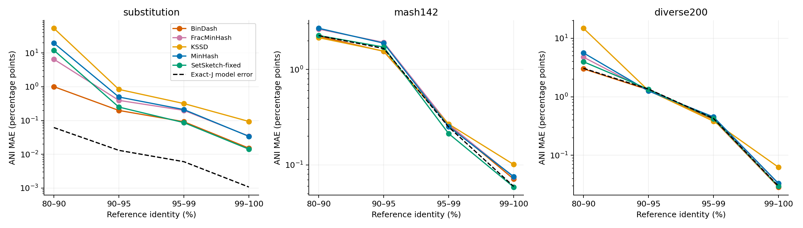
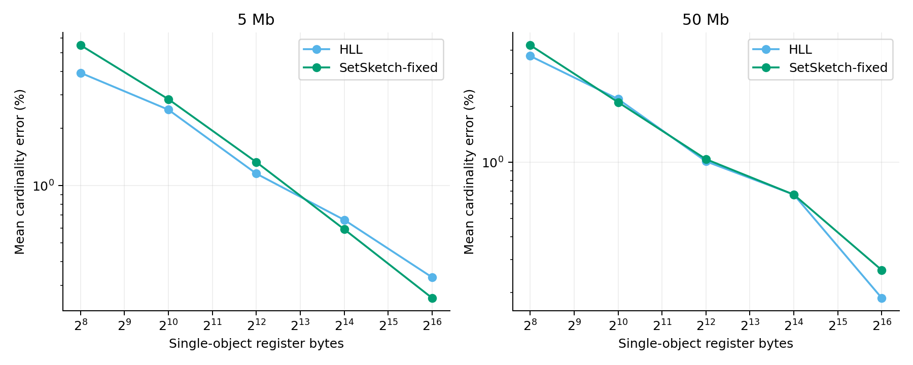
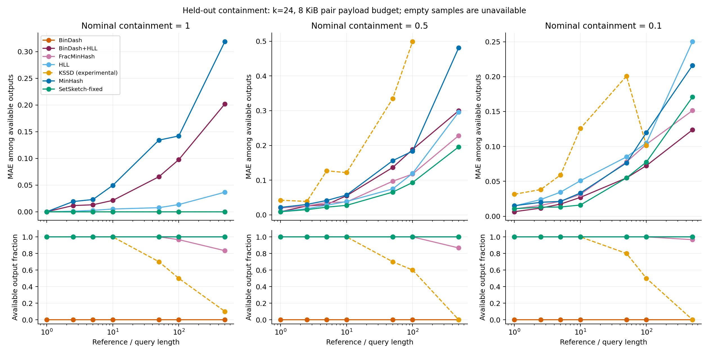
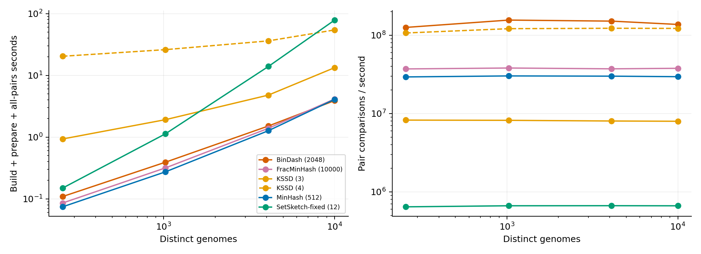
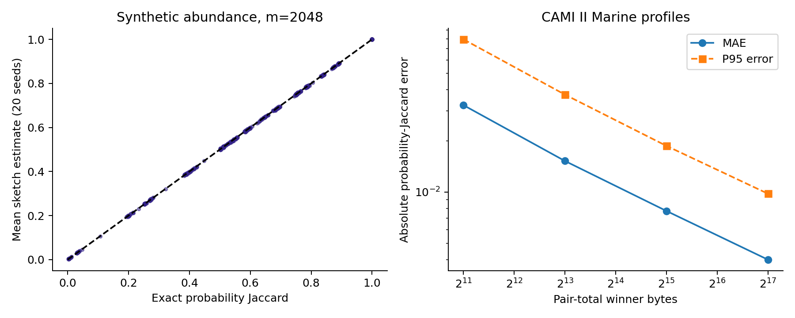
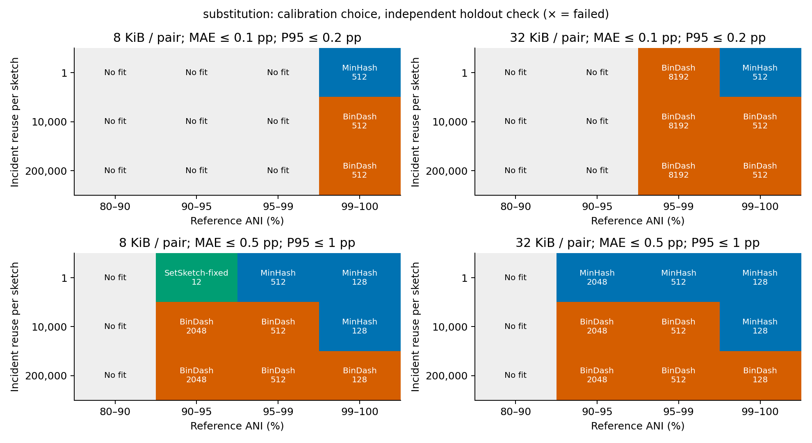
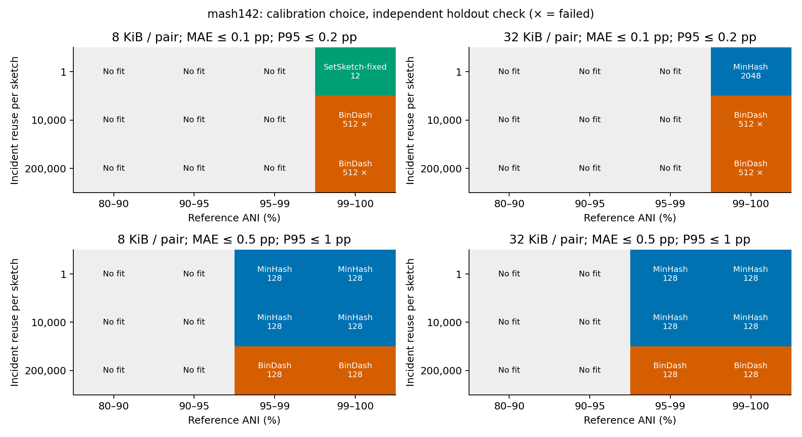

# RabbitSketch2：按任务与成本选择算法的第二阶段结论

本阶段已完成 ANI、cardinality、directed containment、真实 all-vs-all、weighted ProbMinHash 五组评测。恢复 KSSD；按用户要求排除 OrderMinHash。MinHash 始终指当前 FastKMV backend。普通 Jaccard 第一阶段网格保持冻结。

**现在可以给出有条件的选择建议，但不应宣布一个全局赢家，也没有新的全局“90% 被支配”淘汰结论。** 精度、目标 metric、实际 payload 和查询复用共同决定选择；真实 ANI 还受 reference 定义和转换模型影响。

| 用途 | 当前建议 | 必须满足的边界 |
| --- | --- | --- |
| 构建占主要成本的普通集合比较 | MinHash | 先确认该 K 达到误差约束；低 J / 较大 k 时零命中会使 ANI 极不稳定 |
| 内存受限、反复查询、all-vs-all | BinDash | 在本次实测中有明确优势；原生饱和 cardinality 不能用于 containment |
| 高重叠的低采样误差，或其他配置未达到精度约束 | SetSketch-fixed | 查询代价大；真实 alignment ANI 的最优性没有被稳健证明；需要实验修正版本 |
| distinct k-mer cardinality | HLL | 与 SetSketch 精度相近，小输入的构造开销更低；不能由普通 Jaccard 表现淘汰 HLL |
| 定向 containment，尤其接近完整包含 | FracMinHash | 检查 query 保留样本数和空样本率；size ratio 不能单独决定选择 |
| 相对 abundance / composition similarity | weighted ProbMinHash | 估计 probability Jaccard；不是 min/max weighted Jaccard，也不表示绝对总量差异 |
| KSSD | 暂不作为默认推荐入口 | 本次恢复并测了压缩档；没有形成独占的默认推荐区，但这不等于证明所有 KSSD 配置都被全局支配 |

## 1. 数据、实现和独立验证

* Mash 官方归档的每个 pair ID 有两条冲突记录，因此没有任选一条或平均后冒充 truth。使用本地版本匹配的 **142-genome Mash accession subset**，重新计算 10,011 对 FastANI reference；不是声称完整重现原始 Mash 500。
* 原有 200 对多样性样本重新计算 reference：112 对有双向结果，94 对处于 >=80% 主分析区间；88 对缺失、18 对低于 80%，均单独保留。缺失没有填成 ANI=0。
* 20 个不同属的真实 5 Mb reference，14 个替换比例，形成 280 个已知 positional identity 对照。每个非 KSSD 配置用三个 hash seeds。按 reference 分成 10/10；Mash subset 按 genome 分成 71/71，跨组 pair 不用于选择验证。
* Cardinality：20 个 bacterial reference 的 10 kb/100 kb/1 Mb/5 Mb 窗口，以及五个不重叠的 50 Mb human reference 窗口，共 85 个对象。50 Mb 的证据是长度压力测试，不是五个独立的人类个体。
* Containment：700 对，七个 size ratios × 五个 overlap levels × 20 个 reference。最终版本的 query/reference 和 donor 均在同一 split 内；最初 donor 跨 split 的探索性结果被完整保留，但不混入本报告。
* 所有 set truth 使用完整 canonical 2-bit k-mer 集合，k=20/24；FASTA record 边界和非 ACGT 字符阻断 k-mer。跨配置核对 normalized input digest。KSSD 当前 seed 参数不改变 reduction table，故只算一个 seed，不制造重复样本。
* 性能：256/1,024/4,096/10,000 个不同 assembly accession；每个 genome 只构建一次，每对实际计算一次，每矩阵三遍。10,000 对象产生 **49,995,000** 个非对角 pair。补充紧凑配置在 1,024/10,000 对象上测量。
* Weighted：720 组 synthetic abundance 对照，20 seeds；CAMI II Marine 的 10 个 official profiles / 45 对。输入与原始 setup archive 逐字节一致。验证对象是 genome abundance profiles，不冒充 read/k-mer reconstruction。

最终分析含 **1,290,828 条 native pair measurements**，另有 exact truth、cardinality measurements 和 42 个 all-vs-all 配置/规模批次。所有数值误差默认是 [0,1] 的 fraction；下文 ANI 表明确转成百分点。8 KiB **pair 总 payload** 对对称 sketch 等于每个 4 KiB。

软件基线为 `8db783ea75f597068b72705272ae207c94194e83`。通过已有 `examples/main.cpp -t 64` 入口的测量适配器运行，保留原生 backend 构建/查询；不是把未修改 CLI 的端到端时间当成这些分项时间。SetSketch 使用隔离的 partitioned-joint 修正。62 项回归检查通过。

## 2. ANI：采样误差和参考/模型误差必须分开

本库 native ANI 为 `g(J)=(2J/(1+J))^(1/k)`；另外报告 Mash 的 `1+log(2J/(1+J))/k`。两者不同。精确分解发生在带符号误差上：

`g(J_hat)-ANI_ref = [g(J_hat)-g(J_exact)] + [g(J_exact)-ANI_ref]`。

**绝对 MAE 不可相加。** 某个 sketch 的偏差可能抵消转换偏差，因此 total ANI MAE 低于 exact-J baseline 并不代表它比 exact sets 含有更多信息。

以下是在 Mash142 未用于选择的 genome pairs 上，k=24、8 KiB pair 预算、native ANI 的结果；reference 为双向 FastANI：

| algorithm | ani_bin | MAE (百分点) | P95 (百分点) |
| --- | --- | --- | --- |
| bindash | 95–99 | 0.26344 | 0.48579 |
| bindash | 99–100 | 0.071246 | 0.19905 |
| fracminhash | 95–99 | 0.26611 | 0.6165 |
| fracminhash | 99–100 | 0.074831 | 0.25061 |
| kssd | 95–99 | 0.2684 | 0.62546 |
| kssd | 99–100 | 0.10119 | 0.23467 |
| minhash | 95–99 | 0.25264 | 0.57361 |
| minhash | 99–100 | 0.075623 | 0.21478 |
| setsketch | 95–99 | 0.2131 | 0.42158 |
| setsketch | 99–100 | 0.05879 | 0.16869 |


Exact Jaccard 本身转 ANI 后的残差如下；对真实数据，单纯加大 sketch 并不能消除它：

| family | ani_bin | valid | MAE (百分点) | P95 (百分点) |
| --- | --- | --- | --- | --- |
| diverse200 | 80–90 | 29 | 3.0635 | 4.0681 |
| diverse200 | 90–95 | 6 | 1.3539 | 1.9854 |
| diverse200 | 95–99 | 32 | 0.42728 | 0.77051 |
| diverse200 | 99–100 | 27 | 0.029781 | 0.12532 |
| mash142 | 80–90 | 17 | 2.2649 | 2.8104 |
| mash142 | 90–95 | 385 | 1.6597 | 2.4859 |
| mash142 | 95–99 | 2010 | 0.24971 | 0.43175 |
| mash142 | 99–100 | 73 | 0.059643 | 0.15507 |
| substitution | 80–90 | 20 | 0.061959 | 0.1324 |
| substitution | 90–95 | 30 | 0.013102 | 0.03277 |
| substitution | 95–99 | 50 | 0.0060496 | 0.015718 |
| substitution | 99–100 | 40 | 0.0010758 | 0.0047004 |


低 ANI 区也存在 sampling failure：在 substitution 的 80–90% 区、k=24、8 KiB pair 下，MinHash 的零命中造成很大的 ANI 尾部误差；BinDash 更稳。完整零估计率、MAE/P95、k=20 对照见 `ani_zero_rate.csv`、`ani_budget_accuracy.csv`。95%±1 pp 与 99%±0.5 pp 的判断结果在 `ani_threshold_errors.csv`；同时报告含精确阈值点与排除精确阈值点的结果，避免把边界点天然的方向不确定性混成分类能力。

### 独立 alignment reference 复核

使用 MUMmer 4.0.1 NUCmer/dnadiff 对固定分层抽取的 74 对复核，71 对达到双侧 1-to-1 aligned-length fraction >=0.2。所有 74 对上，FastANI 与 NUCmer identity 的平均差为 **0.548 pp**，最大 **4.102 pp**。两种 reference 分开报告；不能用这个差异直接断言其中一种就是绝对真值。

尤其是相同的 Mash audit pairs、相同配置，排序也可能随 reference 改变。下面的 MAE 单位均为百分点：

| algorithm | pairs | mae_vs_fastani | mae_vs_nucmer |
| --- | --- | --- | --- |
| bindash | 11 | 0.24271 | 0.15897 |
| setsketch | 11 | 0.19804 | 0.22452 |


**SetSketch 的高重叠 sampling-error 优势有证据；“SetSketch 是最好的 strain-level alignment ANI 方法”目前证据不足。** `paired_ani_intervals.csv` 在 genome 层重采样，而不是把相关的 all-pairs 当独立样本。在 Mash heldout 的 99–100%、k=24、8 KiB 下，SetSketch−BinDash sampling-error 区间为负，但 total-ANI-error 区间包含零。区间是 pointwise、以三个已测 seed 为条件，没有多重比较校正。



## 3. Cardinality：保留 HLL 的独立角色

k=24、p=12（每个 sketch 4 KiB registers）的结果：

| algorithm | length | n | 相对 MAE (%) | 相对 P95 (%) |
| --- | --- | --- | --- | --- |
| hll | 10000 | 60 | 1.0902 | 2.6487 |
| hll | 100000 | 60 | 1.1433 | 3.2732 |
| hll | 1000000 | 60 | 1.106 | 3.16 |
| hll | 5000000 | 60 | 1.1581 | 3.2064 |
| hll | 50000000 | 15 | 1.0136 | 1.9371 |
| setsketch | 10000 | 60 | 0.97561 | 2.0652 |
| setsketch | 100000 | 60 | 1.1602 | 2.6735 |
| setsketch | 1000000 | 60 | 1.2354 | 3.3101 |
| setsketch | 5000000 | 60 | 1.3315 | 3.0797 |
| setsketch | 50000000 | 15 | 1.0411 | 1.7296 |


同组构造与 cardinality evaluation 时间之和，单位微秒（分别取中位数后相加）：

| algorithm | length | build_plus_card_us |
| --- | --- | --- |
| hll | 10000 | 123.75 |
| hll | 100000 | 523.85 |
| hll | 1000000 | 4502.4 |
| hll | 5000000 | 21895 |
| hll | 50000000 | 2.0525e+05 |
| setsketch | 10000 | 341.45 |
| setsketch | 100000 | 906.07 |
| setsketch | 1000000 | 4960.5 |
| setsketch | 5000000 | 22215 |
| setsketch | 50000000 | 2.1231e+05 |


两者的 cardinality 精度处于相近水平，没有证据说 SetSketch 全面替代 HLL。HLL 在小输入时构造更轻；在长序列上主要成本是遍历序列，差距缩小。若只要 distinct count，HLL 是清晰的推荐；若同时要较准确的 joint similarity，SetSketch 才有额外价值。



## 4. Directed containment：关键是 query 样本量，不是一个普适 ratio 阈值

最终 holdout、k=24、8 KiB pair、nominal containment=0.5：

| algorithm | nominal_ratio | mae | p95 | availability |
| --- | --- | --- | --- | --- |
| bindash_hll | 10 | 0.055163 | 0.1163 | 1 |
| bindash_hll | 50 | 0.13647 | 0.2684 | 1 |
| bindash_hll | 100 | 0.18822 | 0.48755 | 1 |
| bindash_hll | 500 | 0.30003 | 0.50033 | 1 |
| fracminhash | 10 | 0.037134 | 0.087579 | 1 |
| fracminhash | 50 | 0.096823 | 0.2261 | 1 |
| fracminhash | 100 | 0.11751 | 0.30836 | 1 |
| fracminhash | 500 | 0.22817 | 0.50023 | 0.86667 |
| minhash | 10 | 0.05721 | 0.12731 | 1 |
| minhash | 50 | 0.1561 | 0.33048 | 1 |
| minhash | 100 | 0.18346 | 0.43554 | 1 |
| minhash | 500 | 0.48111 | 0.50251 | 1 |
| setsketch | 10 | 0.027415 | 0.065318 | 1 |
| setsketch | 50 | 0.065483 | 0.16503 | 1 |
| setsketch | 100 | 0.093191 | 0.23347 | 1 |
| setsketch | 500 | 0.19583 | 0.39293 | 1 |


这里比较的是 joint Jaccard + native cardinalities 的、有物理边界的 directed estimate；空 sample/非有限 cardinality 记为 unavailable。SetSketch/HLL 路径与 UnifiedQuery 的 common-intersection cap 一致。低级 native containment 的误差另外存档，**KSSD 的 sampled containment 只是实验诊断，当前 public query contract 不支持该指标**。

在完整包含 C=1 时，FracMinHash 对非空 query samples 给出 1；这有明确价值。但在部分重叠，SetSketch 往往更准，代价是更贵的查询。FracMinHash 相比 MinHash 在多种不平衡条件下改善误差，却不能保证在所有比例/overlap 上获胜。BinDash 原生 occupancy cardinality 在这些 genome 数据中饱和；组合 **BinDash+HLL** 已单独计入两份 payload 和两次构建，仍不能自动成为所有 containment 条件的赢家。

对 FracMinHash，令 r=distinct-cardinality ratio，B 是 pair 总 payload，忽略有限样本波动，query 样本数约为：

`m_query ≈ B / [8(1+r)]`。

8 KiB、r≈500 只提供约 **2 个 query hashes**；本实现 native scaled 档位还会造成实际利用率差异。因此 empty sample 和宽误差是预期风险。若 C≈0.5，希望 P95 绝对误差约 <=0.1，简单二项正态近似需约 96 个 query samples，对 r≈500 对应约 **376 KiB pair payload**；这是预算量级估算，不是本次实测过的保证。

可执行建议是：**先由 query cardinality、误差要求确定必要 sample count，再决定 scaled 和总预算；然后比较 FracMinHash 与 register/joint-estimator 的成本。** 不能写“ratio>50 就用 FracMinHash”。



图的上排 MAE 以有效输出为条件，下排同时给出有效输出比例；两者必须一起判断。KSSD 虚线仅为实验性推导，BinDash 单独使用时在这些数据上没有可用的 cardinality-derived containment。

## 5. 实测 all-vs-all：查询复用确实会改变选择

以下是 10,000 assemblies、49,995,000 pairs 的实测。`build_total` 包括 shared setup、构建及 query-cache preparation；query 为三遍矩阵时间中位数。单位秒。payload 列为每对象均值，并非固定-size 方法之外的逐对象上限。

| algorithm | parameter | mean_bytes_per_object | build_total | query_wall_median | total_seconds |
| --- | --- | --- | --- | --- | --- |
| minhash | 512 | 4096 | 2.3897 | 1.696 | 4.0856 |
| bindash | 2048 | 4096 | 3.5329 | 0.36545 | 3.8984 |
| kssd | 3 | 8348 | 7.0313 | 6.2852 | 13.317 |
| setsketch | 12 | 4096 | 3.17 | 75.336 | 78.506 |
| fracminhash | 10000 | 3528.6 | 2.8152 | 1.3258 | 4.141 |
| minhash | 2048 | 16384 | 2.7014 | 6.614 | 9.3154 |
| bindash | 8192 | 16384 | 3.675 | 2.1396 | 5.8146 |
| kssd | 2 | 1.3687e+05 | 7.8904 | 98.051 | 105.94 |
| kssd | 4 | 264.44 | 53.944 | 0.41055 | 54.355 |
| minhash | 128 | 1024 | 2.3779 | 0.45222 | 2.8301 |
| bindash | 512 | 1024 | 3.4876 | 0.10545 | 3.5931 |
| bindash | 128 | 256 | 3.4454 | 0.036218 | 3.4816 |


这些总成本**不含 FASTA/gzip parsing 和矩阵写盘**；parse 时间单独保存在 CSV，受缓存和执行顺序影响，不能借此做算法间冷 I/O 排名。矩阵实际遍历所有 pairs，以 checksum 消费结果，没有写出完整距离矩阵。RSS 包含所有驻留 FASTA 与 reader/shared allocations，不能把约几十 GiB 的 process RSS 解释成 sketch resident memory。

采用 `T=N*B_build+P*t_pair`。若 R 是每对象参与的比较次数，则 `P=N*R/2`，所以 `T/N=B_build+(R/2)*t_pair`。若采用 Q=P/N 的记账定义，则才是 `B_build+Q*t_pair`。两种 Q 定义不能混用。

用 N=10,000 的吞吐数据拟合固定配置的 crossover：

| minhash_parameter | bindash_parameter | Q_charged_crossover | incident_reuse_crossover | allpairs_N_crossover |
| --- | --- | --- | --- | --- |
| 128 | 512 | 15999 | 31997 | 31998 |
| 512 | 2048 | 4295.8 | 8591.6 | 8592.6 |
| 2048 | 8192 | 1087.8 | 2175.7 | 2176.7 |


MinHash K=512 与 BinDash bins=2048 的相同 8 KiB pair 配置，在约 **8.6k genomes** 处发生模型转折；32 KiB 配置约 **2.2k genomes**。256/1,024/4,096/10,000 的实测矩阵提供了规模检查。不是旧的同一 pair 缓存循环外推。

这些是该硬件、64 threads、混合细菌库上的 **throughput model**，不是单 pair latency 或跨平台常数。N beyond 10,000、200,000 次 incident reuse 的成本只属于模型推算。固定字节比较的 crossover 也不是在满足误差后重新选参数的最优 crossover。



## 6. KSSD：已验证高压缩档，但不强行给它安排独占角色

恢复了 dr=2/3（half_subk=6）与 dr=4（half_subk=7）。dr=4 在 10,000 genomes 上约 264 bytes/object，确实很紧凑；但 shared dictionary setup 很贵，连同构建约 54 秒，查询约 0.41 秒。为公平比较，另外测了 256 bytes/object 的 BinDash 128 bins：构建约 3.45 秒、查询约 0.036 秒。

紧凑配置在 substitution holdout、k=24 的 ANI 误差如下，单位百分点：

| algorithm | parameter | ani_bin | mae | p95 |
| --- | --- | --- | --- | --- |
| bindash | 128 | 90–95 | 0.90559 | 2.3418 |
| bindash | 128 | 95–99 | 0.41494 | 1.3001 |
| bindash | 128 | 99–100 | 0.055609 | 0.21854 |
| kssd | 4 | 90–95 | 0.8363 | 2.7668 |
| kssd | 4 | 95–99 | 0.31847 | 1.3125 |
| kssd | 4 | 99–100 | 0.094004 | 0.34443 |


不能据此说 BinDash 在每个精度 cell 都支配 KSSD；例如某些中等 identity 区 KSSD 的 MAE 较小。整数 dr 档位导致分辨率跨度大，k 改变还会改变 tuple 宽度。当前结论是 **KSSD 没有在本次 constraint-based 默认 selection map 中建立独立入口**；保留完整结果和 library backend，降低默认推荐优先级。没有把这一结论升级成跨全部数据/参数的算法淘汰定理。

## 7. Weighted ProbMinHash：定位为 probability Jaccard

先校验 estimand，再评价：winner collision 估计的是 J_P。相同 support 而 abundance 改变时，ordinary set Jaccard 固定为 1，但 J_P 和 ProbMinHash estimate 会变化。相反，全部 weights 乘 10，J_P 仍为 1；min/max Jaccard 却为 0.1。该缩放不变性已由 native tests 和实验共同验证。

CAMI II Marine 的 45 对 official profiles，每配置 20 seeds：

| parameter | n | mae | p95 | query_bytes_per_object |
| --- | --- | --- | --- | --- |
| 128 | 900 | 0.032467 | 0.079247 | 1024 |
| 512 | 900 | 0.015243 | 0.037465 | 4096 |
| 2048 | 900 | 0.0077447 | 0.018708 | 16384 |
| 8192 | 900 | 0.0040036 | 0.0097884 | 65536 |


m=2048（winner query payload 每对象 16 KiB）时 MAE≈0.00775、P95≈0.01871；随 m 增加误差稳定降低。**需要相对 abundance/composition 时选它；需要 min-mass overlap 或绝对总 abundance 时，不应把它的输出叫 weighted Jaccard。** 当前源代码中的部分注释、weighted-containment 推导仍混用了定义，复现与边界见 [METRIC_AUDIT.md](METRIC_AUDIT.md)。本 benchmark 没有使用这些无效派生量进行打分。



## 8. 约束驱动的选择图与可运行原型

固定 calibration/validation 拆分；在 calibration 上先要求 MAE<=epsilon、P95<=2epsilon、observed payload<=budget，再在有实际 workload timing 的配置中最小化成本。随后检查独立 holdout，未达标时显示失败，不换一个 test 集表现更好的配置冒充预先选择。图中“无解”只表示当前已测候选，绝不声称不存在其他参数。

本次 96 个离散请求中，45 个在 calibration 上选到配置，4 个所选配置未通过 holdout。低 ANI 或真实 alignment 定义下的严格误差要求经常不可满足，这种输出比强行推荐一个 backend 更正确。





已提供 `benchmarks/regimes/advise.py`。例如已知 substitution 场景、99–100% 区间、k=24、pair budget=8 KiB、MAE<=0.001/P95<=0.002：一次 incident query 可选 MinHash K=512；incident reuse=10,000 时选 BinDash bins=512，实际只用 2 KiB pair payload。**预算是上限，不要求总是把预算花满。** 这个原型只在已测范围查证据，不是已经部署进 production library 的通用 advisor。

```bash
/home/bigssd/zt/rabbitsketch2_benchmark/venv/bin/python \
  benchmarks/regimes/advise.py --ani-bin '99–100' \
  --target-error 0.001 --pair-budget 8192 --queries-per-sketch 10000
```

## 9. 可写进论文的主结论

> RabbitSketch2 selection depends on the target estimand, error tolerance, payload budget and query reuse. BinDash provides strong accuracy per byte and benefits from repeated comparisons, whereas MinHash is attractive when construction dominates and its accuracy is sufficient. Register-based joint estimation can reduce sampling error but incurs substantially higher query cost. Fractional sampling has a clear containment role only when the query retains enough samples. HLL remains useful for cardinality-only tasks, and weighted ProbMinHash is appropriate for probability-Jaccard comparisons of abundance profiles. Sketch sampling error must be separated from the model and reference-method differences involved in genomic ANI inference.

这比“所有算法各有一个优点”更具体：普通推荐由约束决定，特殊 metric 分赛道；KSSD 的低优先级由这批实测支持，OrderMinHash 则是未测而非被淘汰。

适用范围是本次 k=20/24、单台 Intel Xeon Platinum 8375C、64 threads 和已测数据。受控 ANI 只覆盖 substitutions，没有把结果扩展为 indel/rearrangement 或所有物种的保证；跨架构性能以及超过 10,000 genomes 的实际矩阵也不属于本次实测。

## 10. 产物与复现

* 全部统计表、pointwise intervals、threshold 分类表、selection 请求/结果：本目录 CSV/JSON。
* 图同时有 PNG 和可导出的 PDF；本目录 `completion.json` 记录交付哈希与运行目录。
* 主运行 `runs/regimes_20261001`；补充 `runs/regimes_supplement_20261001`；最终 containment `runs/containment_holdout_20261001`；compact 对照 `runs/compressed_validation_20261001`。各自有 binary/source snapshots、逐批命令、输入 SHA256 和原始输出。
* [实验约定](PROTOCOL.md)、[metric 审计](METRIC_AUDIT.md)、[执行说明](README.md)；原阶段结果见 `../systematic_20261001/report.md`。原生 library 生产目录没有被这些实验替换。

参考方法：[Mash supporting data](https://mash.readthedocs.io/en/latest/data.html)、[Mash distance](https://mash.readthedocs.io/en/latest/distances.html)、[FastANI](https://github.com/ParBLiSS/FastANI)、[MUMmer4](https://github.com/mummer4/mummer)、[ProbMinHash](https://github.com/oertl/probminhash)、[probability Jaccard](https://arxiv.org/abs/1809.04052)、[CAMI II](https://www.nature.com/articles/s41592-022-01431-4)。
