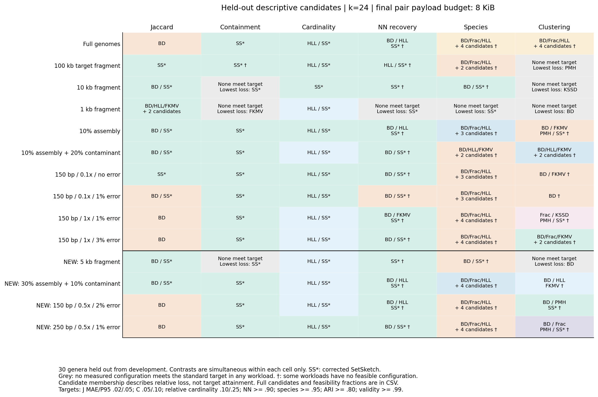
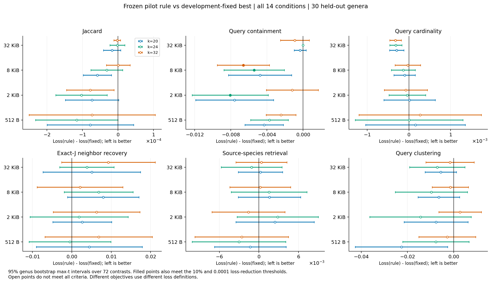
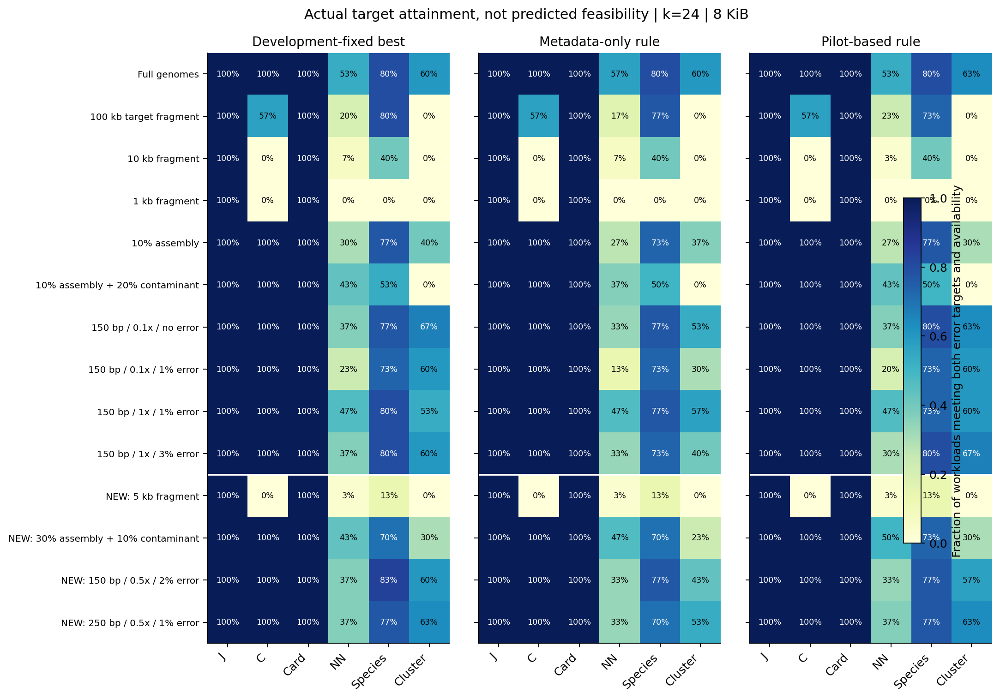
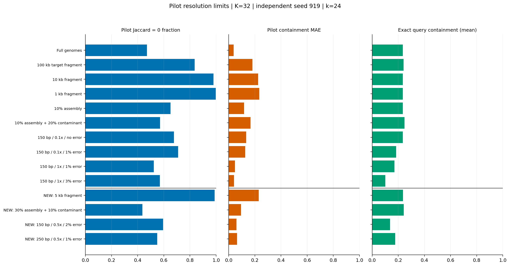
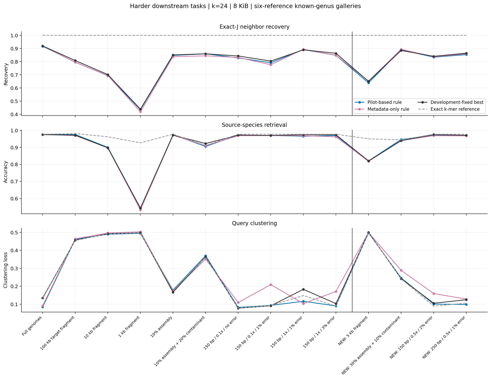

# RabbitSketch2：可观测场景选型的独立验证（2026-11-05）

本轮完成了“可观测输入 → 冻结规则和参数 → 按属留出的新基因组、新随机种子、未见输入条件验证”的实验链条。目标是检验精度与空间约束下的选择，不预设自动选择一定有效。下面的候选图与冻结规则是两个不同产物：候选图总结验证后的证据，规则的全部决定则在验证结果计算前已经保存。

冻结的 pilot 规则在 72 个预定义任务/k/预算汇总对比中，有 **3 项**同时满足跨 72 项的 95% bootstrap 区间和至少 10%（且绝对 0.0001）的损失下降门槛；另有 **0 项**的同时区间明确落在固定方案更好的方向。这些计数不能替代各任务的效应大小，也不能解释成通用最优选择器已经成立。

尤其是 k=24/8 KiB：containment 平均损失从 0.049873 降到 0.044445，但实际达标率仍为固定方案 75.48%、规则 75.48%。该汇总收益全部来自 1 kb 片段；这个场景下所有已测配置仍未达到预设 containment 目标。因此这项统计收益不能作为“选择产生了可用方案或改善下游”的证据。

## 数据与独立性

- 开发：900 个旧基因组、60 个属、600 个工作负载；旧验证半区也归入开发，不能再当作新证据。
- 验证：**450 个新基因组、90 个物种、30 个留出属**，覆盖 25 个科、3 个门；accession/配对别名、BioSample、序列指纹与全部历史输入无重叠，属与本轮 60 个开发属无重叠。
- 范围更正：这 30 个属都在更早的大规模面板中出现过，因此不能称为整个项目从未使用过的属。最初登记措辞过宽；`historical_genus_audit.json` 与 `REPORTING_NOTES.md` 明确记录了这一点。没有因此更换验证数据或重新训练规则。
- 验证查询来自 270 个独立来源基因组，对照库为 180 个其他基因组。每个属是 9 个查询来源、6 个参考；每种条件得到一个工作负载。
- 10 种原条件 + 4 种未见条件，共 420 个验证工作负载；k=20/24/32，pair payload=512 B/2 KiB/8 KiB/32 KiB。
- 564 个原生作业、**26,330,952 条算法/配置/配对测量**，另有 286,206 条精确集合配对结果。重复配置、种子、派生查询不增加生物学独立样本数；区间的独立单位仍为 30 个验证属。
- 所有读段均为真实组装的受控派生：均匀位置采样、均匀替换错误、保留 record 边界。这不是实测测序平台数据，也不覆盖蛋白质或全局未知物种数据库检索。
- 100 kb 是目标片段长度：开发集 540 条中 6 条、验证集 270 条中 2 条因 contig 长度限制截短，最短分别为 59,242/70,301 bp。所有真值及 pilot 特征均使用实际序列；实际输入规模见 `input_condition_summary.csv`。
- 物种标签来自冻结的 NCBI 元数据。验证集无名称为 sp./uncultured/unclassified/bacterium 的分组；开发集含 1 个这样的 TaxID 分组（5 个基因组）。标签检索成绩不等同于经过比对确认的 ANI。

## 先看可以使用的场景候选

下表固定 k=24、最终 pair payload≤8 KiB。每个算法的参数由开发数据选择；候选保留了不能以本场景内同时区间和实际效应门槛排除的算法。不同表格单元之间没有全局多重比较保证，不能把描述性第一名写成每个场景唯一赢家。
“†”表示该场景仍有一部分工作负载在整个候选网格中都没有满足标准目标的配置；灰格/“全部未达标”需要回退或放宽约束，不能推荐最低 MAE 的算法作为可用解。

| 输入条件 | Jaccard | 查询 containment | 查询基数 | 最近邻恢复 | 物种检索 | 聚类 |
| --- | --- | --- | --- | --- | --- | --- |
| fragment_100k | SetSketch-fixed | SetSketch-fixed † | HLL / SetSketch-fixed | HLL / SetSketch-fixed † | BinDash / FracMinHash / HLL / FastKMV / SetSketch-fixed † | 全部已测配置未达标；最低损失：ProbMinHash |
| fragment_10k | BinDash / SetSketch-fixed | 全部已测配置未达标；最低损失：SetSketch-fixed | SetSketch-fixed | SetSketch-fixed † | BinDash / SetSketch-fixed † | 全部已测配置未达标；最低损失：KSSD |
| fragment_1k | BinDash / HLL / FastKMV / ProbMinHash / SetSketch-fixed | 全部已测配置未达标；最低损失：FastKMV | HLL / SetSketch-fixed | 全部已测配置未达标；最低损失：SetSketch-fixed | 全部已测配置未达标；最低损失：SetSketch-fixed | 全部已测配置未达标；最低损失：BinDash |
| full | BinDash | SetSketch-fixed | HLL / SetSketch-fixed | BinDash / HLL / SetSketch-fixed † | BinDash / FracMinHash / HLL / KSSD / FastKMV / ProbMinHash / SetSketch-fixed † | BinDash / FracMinHash / HLL / KSSD / FastKMV / ProbMinHash / SetSketch-fixed † |
| incomplete_10pct | BinDash / SetSketch-fixed | SetSketch-fixed | HLL / SetSketch-fixed | BinDash / HLL / SetSketch-fixed † | BinDash / FracMinHash / HLL / FastKMV / ProbMinHash / SetSketch-fixed † | BinDash / FastKMV / ProbMinHash / SetSketch-fixed † |
| incomplete_10pct_contaminated | BinDash / SetSketch-fixed | SetSketch-fixed | HLL / SetSketch-fixed | BinDash / SetSketch-fixed † | BinDash / HLL / FastKMV / ProbMinHash / SetSketch-fixed † | BinDash / HLL / FastKMV / ProbMinHash / SetSketch-fixed † |
| reads_cov01_clean | SetSketch-fixed | SetSketch-fixed | HLL / SetSketch-fixed | BinDash / SetSketch-fixed † | BinDash / FracMinHash / HLL / FastKMV / ProbMinHash / SetSketch-fixed † | BinDash / FastKMV † |
| reads_cov01_error01 | BinDash / SetSketch-fixed | SetSketch-fixed | HLL / SetSketch-fixed | BinDash / SetSketch-fixed † | BinDash / FracMinHash / HLL / FastKMV / ProbMinHash / SetSketch-fixed † | BinDash † |
| reads_cov1_error01 | BinDash | SetSketch-fixed | HLL / SetSketch-fixed | BinDash / FastKMV / SetSketch-fixed † | BinDash / FracMinHash / HLL / KSSD / FastKMV / ProbMinHash / SetSketch-fixed † | FracMinHash / KSSD / ProbMinHash / SetSketch-fixed † |
| reads_cov1_error03 | BinDash | SetSketch-fixed | HLL / SetSketch-fixed | BinDash / SetSketch-fixed † | BinDash / FracMinHash / HLL / KSSD / FastKMV / ProbMinHash / SetSketch-fixed † | BinDash / FracMinHash / FastKMV / ProbMinHash / SetSketch-fixed † |
| unseen_fragment_5k | BinDash / SetSketch-fixed | 全部已测配置未达标；最低损失：SetSketch-fixed | HLL / SetSketch-fixed | SetSketch-fixed † | BinDash / SetSketch-fixed † | 全部已测配置未达标；最低损失：BinDash |
| unseen_incomplete_30pct_contam10 | BinDash / SetSketch-fixed | SetSketch-fixed | HLL / SetSketch-fixed | BinDash / HLL / SetSketch-fixed † | BinDash / FracMinHash / HLL / KSSD / FastKMV / ProbMinHash / SetSketch-fixed † | BinDash / HLL / FastKMV † |
| unseen_reads250_cov05_error01 | BinDash | SetSketch-fixed | HLL / SetSketch-fixed | BinDash / SetSketch-fixed † | BinDash / FracMinHash / HLL / KSSD / FastKMV / ProbMinHash / SetSketch-fixed † | BinDash / FracMinHash / ProbMinHash / SetSketch-fixed † |
| unseen_reads_cov05_error02 | BinDash | SetSketch-fixed | HLL / SetSketch-fixed | BinDash / HLL / SetSketch-fixed † | BinDash / FracMinHash / HLL / KSSD / FastKMV / ProbMinHash / SetSketch-fixed † | BinDash / ProbMinHash / SetSketch-fixed † |

SetSketch-fixed 始终指隔离实验中的修正版；不能把结果直接归于未修正的生产版本。KSSD/无权 ProbMinHash 的 containment 和 cardinality 被明确视为不支持；BinDash 的可用性还受其原生基数估计影响。

## 冻结选择是否真正改善结果

基线是在开发集按任务、输入 kind、k 和预算选出的最强固定配置，不是随意挑一个较弱算法。下表为 k=24/8 KiB，全部 14 种验证条件按属等权汇总。损失越小越好：J/C 为绝对误差；基数为截断到 1 的相对误差；最近邻/物种为 1−期望并列评分；聚类为 (1−ARI)/2。不可用或超预算结果损失为 1。不同任务的损失不能混成一个总分。

| 任务 | 选择策略 | 失败惩罚后损失 | 可用且预算内比例 | 相对事后最小损失的遗憾 |
| --- | --- | --- | --- | --- |
| cardinality | fixed | 0.01217 | 1.00000 | 0.00099 |
| cardinality | metadata | 0.01215 | 1.00000 | 0.00098 |
| cardinality | pilot | 0.01203 | 1.00000 | 0.00086 |
| clustering | fixed | 0.25281 | 1.00000 | 0.04804 |
| clustering | metadata | 0.26784 | 1.00000 | 0.06306 |
| clustering | pilot | 0.24316 | 1.00000 | 0.03839 |
| containment | fixed | 0.04987 | 1.00000 | 0.00700 |
| containment | metadata | 0.04426 | 1.00000 | 0.00139 |
| containment | pilot | 0.04445 | 1.00000 | 0.00157 |
| jaccard | fixed | 0.00201 | 1.00000 | 0.00008 |
| jaccard | metadata | 0.00197 | 1.00000 | 0.00005 |
| jaccard | pilot | 0.00197 | 1.00000 | 0.00005 |
| neighbor | fixed | 0.19837 | 1.00000 | 0.04881 |
| neighbor | metadata | 0.20673 | 1.00000 | 0.05718 |
| neighbor | pilot | 0.20518 | 1.00000 | 0.05562 |
| species | fixed | 0.07971 | 1.00000 | 0.01994 |
| species | metadata | 0.08397 | 1.00000 | 0.02420 |
| species | pilot | 0.08125 | 1.00000 | 0.02148 |

| 任务 | 固定方案损失 | pilot 规则损失 | 规则−固定 | 同时区间下界 | 同时区间上界 | 达到实际收益门槛 |
| --- | --- | --- | --- | --- | --- | --- |
| cardinality | 0.01217 | 0.01203 | -0.00014 | -0.00042 | 0.00015 | False |
| clustering | 0.25281 | 0.24316 | -0.00965 | -0.02528 | 0.00598 | False |
| containment | 0.04987 | 0.04445 | -0.00543 | -0.00877 | -0.00208 | True |
| jaccard | 0.00201 | 0.00197 | -0.00003 | -0.00008 | 0.00001 | False |
| neighbor | 0.19837 | 0.20518 | 0.00681 | -0.00191 | 0.01553 | False |
| species | 0.07971 | 0.08125 | 0.00154 | -0.00421 | 0.00728 | False |

全部 72 项以及各场景的配对区间见 `advisor_vs_fixed_intervals.csv`。场景区间是逐项区间；主要汇总区间才在每个选择器的 72 项对比内同时校正。随机种子先在属内平均，区间不覆盖所有可能哈希种子的额外不确定性。

## 预测达标不等于实际达标

标准精度要求：J MAE≤0.02/P95≤0.05；C≤0.05/0.10；基数相对误差≤0.10/0.25；最近邻恢复≥90%；物种准确率≥95%；聚类 ARI≥0.80。同时要求至少 99% 可用且在预算内的输出、最多 1% 超预算输出。P95 先在每个工作负载内计算；预测取邻近工作负载 P95 的平均，属于经验预测而非置信上界。

| 任务 | 预测达标覆盖率 | 实际达标率 | 预测达标中的错误比例 | 有可行方案时选错的比例 | 所有已测配置均未达标的比例 |
| --- | --- | --- | --- | --- | --- |
| cardinality | 1.00000 | 1.00000 | 0.00000 | 0.00000 | 0.00000 |
| clustering | 0.40952 | 0.35238 | 0.29070 | 0.16854 | 0.57619 |
| containment | 0.74524 | 0.75476 | 0.00000 | 0.00000 | 0.24524 |
| jaccard | 1.00000 | 1.00000 | 0.00000 | 0.00000 | 0.00000 |
| neighbor | 0.21667 | 0.29048 | 0.48352 | 0.35450 | 0.55000 |
| species | 0.76190 | 0.61905 | 0.26562 | 0.14474 | 0.27619 |

所选配置不达标，不等于这个预算下没有可行算法。表中分别检查“存在达标配置却选错”和“全部已测配置都未达标”；后者也只限本次参数网格。当前规则优化失败惩罚后的平均损失，精度门槛用于推荐后的筛查，还不是直接以 MAE/P95 约束优化的选择器。不能删除空 Sketch、超预算或选错的工作负载后再报好看的 MAE。

## 未见输入条件的迁移

四种未见条件是：5 kb 片段；30% 完整度/10% 污染的 tile 组装；150 bp、0.5×、2% 替换读段；250 bp、0.5×、1% 替换读段。它们在模型冻结前单独登记，只用于验证，没有重新拟合规则或阈值。下表的原条件与未见条件有不同难度分布，应比较各自内部“规则−固定”，不能直接把两组绝对成绩当作同难度比较。

| 任务 | 条件组 | 规则−固定 | 逐项下界 | 逐项上界 |
| --- | --- | --- | --- | --- |
| cardinality | original_conditions | -0.00017 | -0.00037 | 0.00003 |
| cardinality | unseen_conditions | -0.00005 | -0.00026 | 0.00018 |
| clustering | original_conditions | -0.01051 | -0.01963 | -0.00200 |
| clustering | unseen_conditions | -0.00749 | -0.02290 | 0.00725 |
| containment | original_conditions | -0.00760 | -0.01036 | -0.00492 |
| containment | unseen_conditions | 0.00000 | 0.00000 | 0.00000 |
| jaccard | original_conditions | -0.00004 | -0.00007 | -0.00001 |
| jaccard | unseen_conditions | -0.00000 | -0.00004 | 0.00003 |
| neighbor | original_conditions | 0.00718 | 0.00163 | 0.01340 |
| neighbor | unseen_conditions | 0.00589 | -0.00532 | 0.01610 |
| species | original_conditions | 0.00232 | -0.00168 | 0.00607 |
| species | unseen_conditions | -0.00041 | -0.00443 | 0.00340 |

## 短序列的零估计陷阱与 pilot 局限

| 输入 | J 条件 MAE | 恒定输出 0 的 MAE | 正真值配对相对 MAE | J 输出 0 的比例 |
| --- | --- | --- | --- | --- |
| fragment_10k | 0.00026 | 0.00072 | 24.94407 | 0.37840 |
| fragment_1k | 0.00008 | 0.00007 | 7.89781 | 0.45823 |
| full | 0.00367 | 0.17936 | 0.19261 | 0.02016 |
| unseen_fragment_5k | 0.00019 | 0.00035 | 34.42586 | 0.39979 |

小片段对完整基因组可以具有很高的查询 containment，同时 Jaccard 很低。只满足绝对 J 误差并不证明能保持排序、区分近缘对象或准确估计包含率。K=32 pilot 在低交集概率下会频繁输出 0，所以不能把 pilot J=0 理解为两个序列完全不相关。

pilot 每对象最多 256 B，9+6 对象工作负载最多 3,840 B 临时查询载荷。实验在构建最终 Sketch 前释放 pilot；同时保留时必须另计空间。没有评测其输入扫描和构建时间，也没有证明选择本身有端到端性能收益。

## 下游任务与开放集合失败

最近邻参照是精确 k-mer Jaccard 的最优参考；物种评价按来源 TaxID；聚类使用仅在开发数据拟合的单链接阈值。三个任务不能用同一个 MAE 排名互相代替。每个属只有三个候选物种；不能外推为任意大参考库的分类能力。
短片段来自不同基因组位置，查询间可能没有同源重叠；本次单链接阈值网格下，精确集合的 1/5/10 kb 片段 ARI 也接近 0。这属于集合 Jaccard 加当前聚类流程的任务限制，不能把它全归因于 Sketch 误差。

开放集合测试移除查询物种的参考，再检查是否错误接受其他物种。接受阈值只在开发集拟合，目标是 90% 已知查询召回；同时列出实际已知接受率和未知错误接受率。全为零的相似度会导致并列，阈值为零时也可能错误接受未知查询。

| 输入 | 策略 | 已知接受率 | 未知错误接受率 | 已知库可用率 | 移除物种后可用率 |
| --- | --- | --- | --- | --- | --- |
| fragment_1k | fixed | 1.00000 | 1.00000 | 1.00000 | 1.00000 |
| fragment_1k | pilot | 0.71235 | 0.50000 | 1.00000 | 1.00000 |
| full | fixed | 0.97407 | 0.19753 | 1.00000 | 1.00000 |
| full | pilot | 0.97407 | 0.25185 | 1.00000 | 1.00000 |
| reads_cov1_error03 | fixed | 0.96420 | 0.12099 | 1.00000 | 1.00000 |
| reads_cov1_error03 | pilot | 0.96420 | 0.13951 | 1.00000 | 1.00000 |
| unseen_reads_cov05_error02 | fixed | 0.96049 | 0.11481 | 1.00000 | 1.00000 |
| unseen_reads_cov05_error02 | pilot | 0.95802 | 0.12469 | 1.00000 | 1.00000 |

## 可复现的规则与能力边界

实验性的 `advisor.py` 返回候选及经验损失预测。它只使用输入 kind、k、碱基/record 统计以及独立 seed=919 的 K=32 pilot。真实 J/C/基数、物种/属编号、生成覆盖度、错误率和污染比例不参与选择。每个查询工作负载选一套兼容的 backend/参数，不能给已建好的索引临时换算法后跨算法比较。

| 输入 kind | 任务 | 开发集冻结的固定基线配置 |
| --- | --- | --- |
| assembly | jaccard | bindash:2048:6 |
| assembly | containment | setsketch:12:6 |
| assembly | cardinality | hll:12:6 |
| assembly | neighbor | setsketch:12:6 |
| assembly | species | bindash:2048:6 |
| assembly | clustering | bindash:2048:6 |
| contig | jaccard | setsketch:12:6 |
| contig | containment | setsketch:12:6 |
| contig | cardinality | hll:12:6 |
| contig | neighbor | setsketch:12:6 |
| contig | species | bindash:2048:6 |
| contig | clustering | hll:12:6 |
| reads | jaccard | bindash:2048:6 |
| reads | containment | setsketch:12:6 |
| reads | cardinality | setsketch:12:6 |
| reads | neighbor | setsketch:12:6 |
| reads | species | bindash:2048:6 |
| reads | clustering | bindash:2048:6 |

加权 ProbMinHash 的 probability Jaccard、min-max weighted Jaccard 和普通集合 Jaccard 不同。本轮七算法比较只覆盖普通集合语义；加权概率 Jaccard 继续使用上一轮独立加权结果。OrderMinHash 估计顺序相似性，也不应插入这张集合 J 排名表。Legacy MinHash 仍是传统实现基线。不能从不同估计对象之间的能力差异宣称某算法统计上全面占优。

## 文件与审计

- `scenario_candidates.csv` / `algorithm_contrasts.csv`：全部 k/预算/场景的候选与场景内同时区间。
- `validation_decisions.csv.gz`：验证测量之前冻结的 302,400 条决定；`decision_outcomes.csv.gz`：决定与实际结果逐项对应。
- `validation_native_scores.csv.gz` / `validation_native_tasks.csv.gz`：全部候选配置的评分；失败没有删除。
- `precision_profile_summary.csv`：标准/严格门槛下的覆盖率、达标率与错误推荐率。
- `model/`、`example_features.json`、`example_recommendation.json`：可复查的模型和可运行示例。
- `independence_audit.json`、输入/派生来源清单、`native_archive_manifest.csv`：独立性、源文件与全部原生归档的 SHA256。
- `shared_exact_verification.csv`：与旧实验共享的 900 个基因组和每个 k 的 6,300 个无序配对，精确基数/交集全部一致。
- `analysis_tests.log`、`artifact_sha256.json`：分析测试及公开产物校验；完整 FASTA/原生归档仍保存在外部实验目录。

本轮的结论范围是固定实现、细菌组装及上述受控派生、三种 k、四档查询载荷，以及已知属候选库。优化实现本身的性能贡献留待统一性能实验；这里没有加入标量对比或速度排名。
