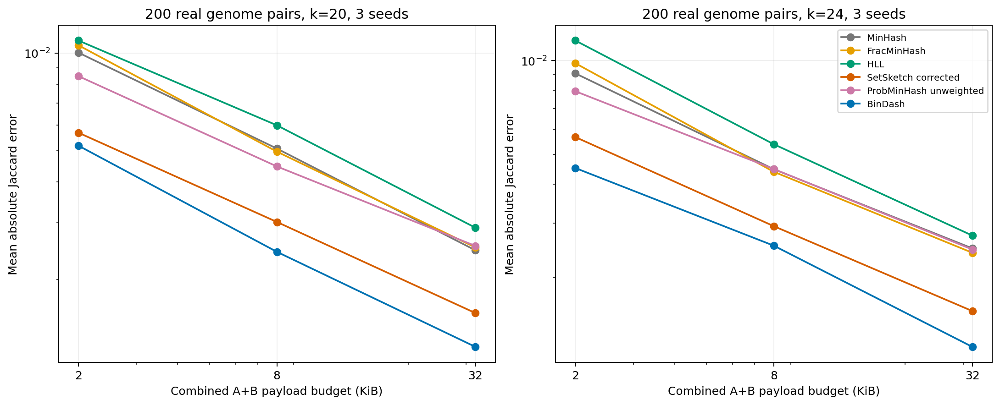
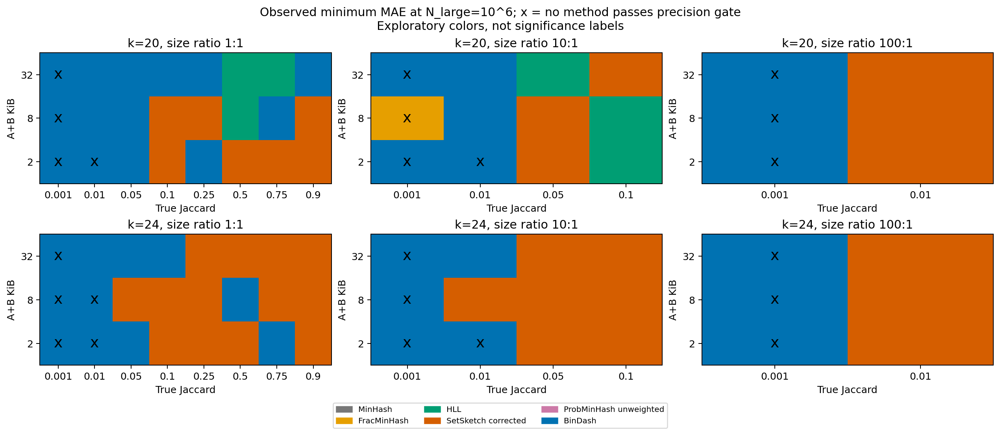
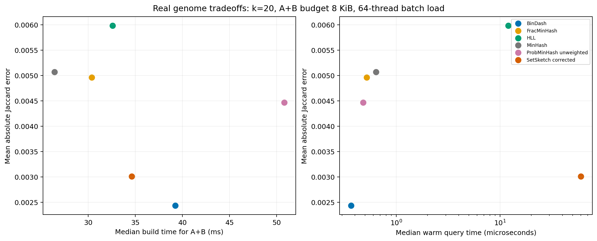

# RabbitSketch2 六候选系统分析（2026-10-01）

本报告得到三条有数据支撑的普通集合使用边界：**在所需精度已经满足时，一次性构建优先考察 MinHash；有限字节预算与频繁查询优先考察 BinDash；高重叠、优先精度的场景考察修正后的 SetSketch。** HLL 的 cardinality 角色单独保留；FracMinHash 和 weighted ProbMinHash 的专门任务价值仍需要对应 estimand 的实验。这不是“六个算法都已经证明不可替代”，也不是已证明剩余算法普遍被支配。

**范围决定：KSSD 和 OrderMinHash 已退出后续评测与选择空间。** 它们的历史结果保留，不写成实验淘汰。当前 MinHash 就是 FastKMV，只计一个候选。

## 1. 已完成的证据

- 原始 pilot：90,720/90,720 成功，包含 KSSD；六候选子集为 84,000 条、50 档 native configuration、84 个可行数据场景、每场景 20 次独立数据重复。
- SetSketch 修正：全部 11,760 条重跑；与原实验逐条核对输入摘要、payload 和 marginal cardinality 一致。修正结果替换分析视图，不覆盖原始数据。
- FracMinHash 字节网格：在 N_large=10^7 补 scaled=20,000/50,000/100,000/200,000，2,240 条成功；当前合成分析视图合计 86,240 条。
- 真实数据：200 对、396 个本地 assembly，k=20/24，seed=42/101/202；400 次 exact truth 计算和 32,400 条 sketch 测量。原清单路径失效，已从同 accession/文件名的本地 gzip 库解压，保存校验值。
- 执行：existing examples/main.cpp 的批次入口，单进程 -t 64；三个补测顺序执行。硬件为 Intel Xeon Platinum 8375C，限本机 64 个可用 logical CPU。
- 53 项 Python 接口/数据检查通过；SetSketch 的 450 个概率模型案例、48 个接口案例及 20 次稀疏回归通过；upstream unified_query_test 通过。

这里的 truth 是 distinct canonical k-mer 集合的精确 Jaccard。**不是 ANI 真值，也不是 directed containment、abundance 或 all-vs-all 性能验证。** 真实 FASTA 的 contig 之间插入 N，精确集合使用无 hash collision 的 2-bit 编码。

## 2. 固定字节预算的精度证据

下表为 `MAE 的 bootstrap 95% 上界 / true J <= 25%` 的合成场景覆盖数。分母为 84；括号内为有完整、无空采样且满足字节预算的场景数。该相对精度门槛是补充诊断，不是新增的预注册淘汰规则。

| 算法 | 2 KiB | 8 KiB | 32 KiB |
|---|---|---|---|
| MinHash (=FastKMV) | 27/84（可用 84） | 47/84（可用 84） | 62/84（可用 84） |
| FracMinHash | 33/84（可用 73） | 47/84（可用 83） | 63/84（可用 84） |
| HLL | 47/84（可用 84） | 49/84（可用 84） | 55/84（可用 84） |
| SetSketch（修正版本） | 51/84（可用 84） | 56/84（可用 84） | 63/84（可用 84） |
| ProbMinHash-unweighted | 28/84（可用 84） | 45/84（可用 84） | 61/84（可用 84） |
| BinDash | 47/84（可用 84） | 62/84（可用 84） | 66/84（可用 84） |

**所有预算均为两个 sketch 的 payload 总和 A+B；不包含对象开销、临时构建内存或序列输入。** 2/8/32 KiB 分别对应 MinHash K=128/512/2048、ProbMinHash m=128/512/2048、BinDash bins=512/2048/8192（16 bits）、HLL/SetSketch p=10/12/14。小于 K 的集合会使 MinHash 实际 payload 低于上限。FracMinHash 按实际观测最大 payload 选参，不按误差选参。

### BinDash 对当前 MinHash

| A+B KiB | BinDash MAE 更低 | MAE 比值中位数 BD/MH | 配对 95% 区间支持 BD 更低 |
|---|---|---|---|
| 2 | 84/84 | 0.509 | 59/84 |
| 8 | 84/84 | 0.484 | 64/84 |
| 32 | 84/84 | 0.490 | 71/84 |

区间是逐格的 paired bootstrap，未做多重比较校正。等预算下 BinDash 的 16-bit signatures 能容纳更多 bins；不要把“bins 数等于 K”当成相同资源。此结论针对当前实现和已测参数，不等于证明所有 bottom-k 方法都多余。

## 3. 真实 genome 验证

每个 pair 的误差先对三个 hash seed 求平均，再汇总 biological pairs。不同 pair 可能复用 assembly；不把 32,400 行当独立样本，不给出错误的 IID 显著性结论。下表比较同一批 pair 上 BinDash 与 MinHash。

| k | A+B KiB | 共同 pairs | MinHash MAE | BinDash MAE | BD/MH | BD 更低的 pairs |
|---|---|---|---|---|---|---|
| 20 | 2 | 200 | 0.0100289 | 0.00517719 | 0.516 | 97 |
| 24 | 2 | 200 | 0.00910223 | 0.00451305 | 0.496 | 97 |
| 20 | 8 | 200 | 0.00507047 | 0.0024337 | 0.480 | 115 |
| 24 | 8 | 200 | 0.00447345 | 0.00253766 | 0.567 | 102 |
| 20 | 32 | 200 | 0.00246078 | 0.00123874 | 0.503 | 137 |
| 24 | 32 | 200 | 0.00248802 | 0.00119907 | 0.482 | 140 |

完整六算法结果见 `real_summary.csv`；按 J 区间和原清单分层的结果见 `real_jaccard_ranges.csv`、`real_tiers.csv`。图只汇总在该 k 的三个预算上都覆盖全部 200 pairs 的算法，避免因可用样本不同产生虚假的整体排名。

## 4. 相似度、大小、大小比例与 k 的作用

下表是 8 KiB、**相同大小**合成集合中，修正 SetSketch / BinDash 的 MAE 比值中位数；每个 J 有 3 档 cardinality × 2 档 k = 6 个场景。小于 1 表示 SetSketch 更低。

| true J | SS/BD 中位数 | SS 更低场景数 |
|---|---|---|
| 0.001 | 3.955 | 0/6 |
| 0.01 | 1.929 | 0/6 |
| 0.05 | 1.287 | 1/6 |
| 0.1 | 0.946 | 4/6 |
| 0.25 | 0.999 | 3/6 |
| 0.5 | 0.911 | 4/6 |
| 0.75 | 0.869 | 4/6 |
| 0.9 | 0.730 | 5/6 |

真实数据在 8 KiB 下也出现相似分界：J>0.5 的 k=20/24 分组分别有 41/38 pairs，SetSketch MAE 为 0.002956/0.003191，BinDash 为 0.004273/0.004174，前者降低约 31%/24%。在 J<=.001 的分组，BinDash 明显更低。此分界是有限样本的分层证据，不是经过阈值搜索验证的通用切换点。

- **低 J 需要更大预算。** 绝对误差 < .005 不能证明分辨出了 J=.001；总报零也会过关。推荐必须同时检查相对误差和零估计比例。
- **大小比例不是独立的赢家开关。** J 不能超过 1/ratio，因此不能把 ratio=1 与 ratio=100 的全部格子直接平均比较。`synthetic_imbalance_matched.csv` 固定 J、k、N_large 后比较比例效应。靠近最大可行 J 的场景意味着较小集合近乎被包含，与两个等大、低重叠集合的统计难度不同。
- **FracMinHash 并未因大小不均自动胜出。** 本次测的是 Jaccard，不能由此断言其 directed containment 无价值，也不能预先给出 size ratio > X 就切换 FracMinHash 的规则。补齐 scaled 后的可用性和误差见完整表；空采样仍须单独处理。
- **k 的结论分层解释。** 在控制 exact J 和 cardinality 的随机集合上，k=20/24 主要检查实现与 hash 稳定性；在真实 genome 上改变 k 会改变 truth 本身。两档 k 不足以宣布一个通用的最优 k。
- **长度范围有限。** 合成实验覆盖 N_large=10^5/10^6/10^7，真实验证使用本地 microbial assemblies。没有完成 >50 Mb 真核、reads 误差、metagenome 或不同 mutation mechanism 的系统外推。

颜色表示观测到的最小 MAE；x 表示该格没有方法通过相对精度门槛。这是探索性 regime map，不是经过独立部署验证的自动 advisor，也不能把颜色变化解释为精确的理论临界点。

## 5. SetSketch 修正与 HLL 的分工

修正后，467/588 个配置场景的 MAE 降低。其余场景同样保留；修正并不保证每个有限样本格子都更优。在 k=20、N_A=10,000、N_B=100,000、I=110、p=16 的 20 次原始 DNA 输入上，平均估计从 0.0557155 降至 0.0009180，MAE 从 0.0547145 降至 0.0003677；真值为 0.0010010。

根因是 native 构建将每个元素分配给一个寄存器，旧联合估计却套用了不匹配的 dense rank-order 模型。修正使用含空寄存器/截断尾部的 partitioned conditional likelihood，marginal cardinalities 单独拟合。静态 inclusion-exclusion 路径也统一了 union-cardinality 模型；旧 tail bound 暂停使用。这是独立实验 worktree 的补丁，没有覆盖用户现有源码，亦不宣称索引性能已验证。

同 p、同 payload 的 HLL/SetSketch 比较：

| p | SS Jaccard MAE 更低 | Jaccard MAE SS/HLL 中位数 | cardinality relative MAE SS/HLL 中位数 |
|---|---|---|---|
| 4 | 65/84 | 0.728 | 1.023 |
| 6 | 74/84 | 0.638 | 1.011 |
| 8 | 80/84 | 0.680 | 1.031 |
| 10 | 77/84 | 0.664 | 1.016 |
| 12 | 76/84 | 0.588 | 1.032 |
| 14 | 80/84 | 0.579 | 1.029 |
| 16 | 80/84 | 0.532 | 0.998 |

Jaccard 与 cardinality 分开判定：联合估计更好不意味着 distinct-count 也更好。保留 HLL 的 cardinality 候选角色，不依据 Jaccard 排名将其一起淘汰。模型推导、测试、复现及实现限制见 `VALIDATION.md` 和 `setsketch_partitioned_joint.patch`。

## 6. 构建、查询复用与实际推荐

以下为真实 pair、8 KiB 下的中位数；构建包含 native hashing/update/finalize，排除读 FASTA 和 exact truth。计时为 64 线程批次负载中的每对 elapsed time，不能直接换算成独占单核延迟或全库吞吐。

| k | 算法 | pairs | 构建一对 ms | warm query μs |
|---|---|---|---|---|
| 20 | BinDash | 200 | 39.234 | 0.368 |
| 20 | FracMinHash | 200 | 30.374 | 0.518 |
| 20 | HLL | 200 | 32.589 | 11.996 |
| 20 | MinHash (=FastKMV) | 200 | 26.418 | 0.640 |
| 20 | ProbMinHash-unweighted | 200 | 50.798 | 0.479 |
| 20 | SetSketch（修正版本） | 200 | 34.607 | 60.179 |
| 24 | BinDash | 200 | 39.176 | 0.368 |
| 24 | FracMinHash | 200 | 30.407 | 0.521 |
| 24 | HLL | 200 | 32.853 | 12.022 |
| 24 | MinHash (=FastKMV) | 200 | 26.469 | 0.645 |
| 24 | ProbMinHash-unweighted | 200 | 51.042 | 0.479 |
| 24 | SetSketch（修正版本） | 200 | 34.916 | 60.128 |

**真实 FASTA 上 MinHash 构建更快，不能据合成 carrier 的 build 排名淘汰它。** 在 8 KiB 下，k=20/24 的一对构建中位数分别约为 MinHash 26.4/26.5 ms、BinDash 39.2/39.2 ms；warm query 分别约为 MinHash 0.640/0.645 μs、BinDash 0.368/0.368 μs。对比的前提是相应精度已经满足，不能为了速度接受不合格的精度。

复用成本使用 `B + cold + (Q−1) × warm`。`real_crossovers.csv` 保存固定配置逐 pair 的正交叉点，并标记双方是否都满足观测精度门槛；`real_reuse_observed.csv` 遍历预算内**所有已测 native configurations**，在观测 MAE <= min(.005, .25J) 的候选中比较 Q=1/100/10,000/1,000,000。这些是当前硬件、当前 native grid、同一对 warm cache 的条件模型；不将其中某个 Q* 写成跨数据集通用阈值。

固定 8 KiB 配置下，全部 200 对的 MinHash/BinDash Q* 中位数约为 5.1 万；**先要求双方都通过上述观测精度门槛后**，只剩 k=20 的 31 对和 k=24 的 23 对，其中位数分别约为 16.1 万和 20.4 万。这说明没有精度约束的 crossover 会误导选择。允许参数随任务选择后，应读取全部配置的条件成本表，而非固定这一个 Q*。

在 8 KiB 内遍历全部已测配置，仍有 k=20 的 109/200 对、k=24 的 108/200 对未达到 `MAE <= min(.005,.25J)`。大量远缘、低 J pairs 对相对精度要求很敏感；如果任务只需区分远缘/近缘，应另行预设相应误差或分类目标。不能把“有返回值”等同于“精度足够”。

| 算法 | 当前建议 | 证据边界 |
|---|---|---|
| BinDash | 普通 set Jaccard、有限预算和重复查询的优先候选 | 16-bit 配置；真实与合成结果均须按 J 区间阅读 |
| SetSketch（修正版本） | 中高重叠或 near-containment、优先精度时与 BinDash 比较 | 必须使用模型修正；查询和索引成本单独评估 |
| MinHash (=FastKMV) | 精度已满足、构建占主导或一次性比较时优先考察 | 真实 FASTA 构建明显更快；等预算精度与频繁查询通常让位于 BinDash |
| HLL | 优先保留为 cardinality 候选 | 不能将其 cardinality 价值用 Jaccard 单一任务否定 |
| FracMinHash | 保留在 scaled sampling / directed containment 后续验证范围 | 普通 Jaccard 尚无仅凭 size ratio 切换的普遍边界 |
| ProbMinHash-unweighted | 普通集合主推荐中降低优先级 | 没有稳定的等字节精度优势；weighted 专场不能从本实验外推 |

weighted ProbMinHash 的目标是 probability Jaccard，不能把它与 min/max weighted Jaccard 混为一谈。参见 [ProbMinHash 作者仓库](https://github.com/oertl/probminhash)。本报告没有跑 abundance truth，所以“优先用于 abundance”目前是任务分工方向，不是已验证的 abundance 性能结论。

## 7. 淘汰结论与论文中可写的范围

去掉 KSSD 后重新计算原六候选前沿，原定规则下仍没有正式算法淘汰对象：

| 算法 | 四目标前沿场景数 | 全部配置稳健被支配场景数 |
|---|---|---|
| MinHash (=FastKMV) | 30/84 | 7/84 |
| FracMinHash | 82/84 | 0/84 |
| HLL | 84/84 | 0/84 |
| SetSketch（原版审计） | 84/84 | 0/84 |
| ProbMinHash-unweighted | 15/84 | 19/84 |
| BinDash | 84/84 | 0/84 |

此表是原版实现的审计记录，包含已发现失配的旧 SetSketch，不作为其最终精度排名。修正 + 扩网格后的 error–space 前沿已对六候选重新计算，见 `synthetic_frontiers.csv`；其四目标列混合了不同执行时段，只作描述，不重新套用预注册淘汰判据。真实实验则在同一修正版本下重新测量所有六种方法。**四维前沿很宽：极小 payload 或某一项极快的配置，即使误差不满足任务需求，也可能在前沿上。** 因此前沿出现次数不是推荐强度；实用选择必须先约束精度，再比较所需任务的总成本。探索性的复用表仍能找到 FracMinHash 等方法的局部可行配置，不能把“不是默认首选”写成“完全没有实用价值”。

论文可以支持的中心论点是：**相同 native 数字不代表相同资源；实际 payload 下的精度、任务 estimand 和查询复用共同影响选择。MinHash 的真实序列构建效率、BinDash 的压缩精度与查询效率、修正 SetSketch 的高重叠精度形成可解释的取舍；其余方法需要依靠特定任务或资源约束证明保留价值。** 目前不能写“已经证明只需要三种算法”，也不能写“FracMinHash 必然赢大尺寸差”或“所有序列类型上通用”。

## 8. 可复现文件

- `synthetic_manifest.json`、`real_manifest.json`、`analysis_version.json`：数据来源、SHA-256、版本和分析规则。
- `synthetic_configurations.csv`、`synthetic_budget_selected.csv`：全部参数统计及资源先行的选参记录。
- `synthetic_paired_comparisons.csv`、`synthetic_dimensions.csv`、`synthetic_imbalance_matched.csv`：配对区间与条件分层。
- `setsketch_before_after.csv`、`synthetic_hll_setsketch.csv`：模型修正和 cardinality 分工证据。
- `real_configurations.csv`、`real_pairwise_comparisons.csv`、`real_jaccard_ranges.csv`：真实样本验证。
- `real_crossovers.csv`、`real_reuse_observed.csv`：条件复用模型，不是 all-vs-all 实测。
- 四张主图均有独立 PNG/PDF；全部 raw data、脚本快照与批次记录在 `/home/bigssd/zt/rabbitsketch2_benchmark/runs/`。
