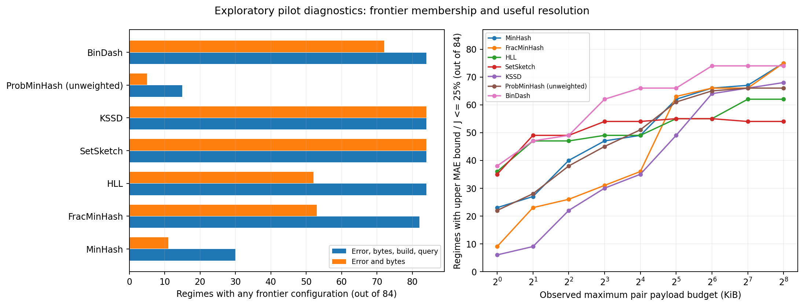
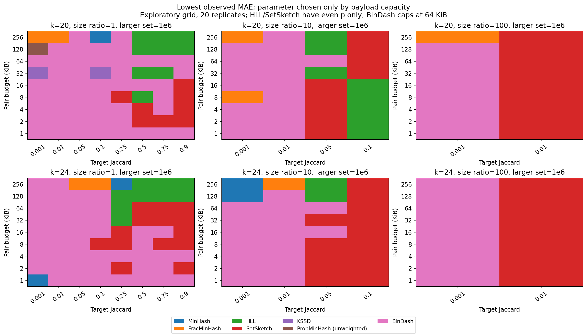
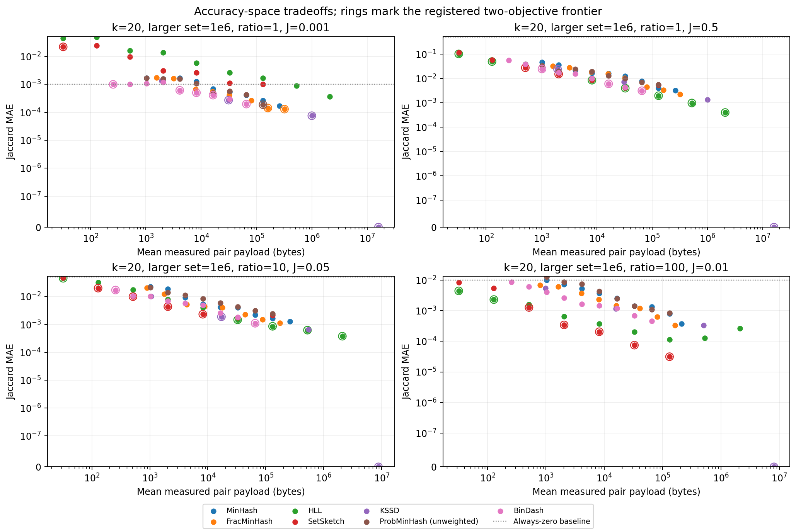
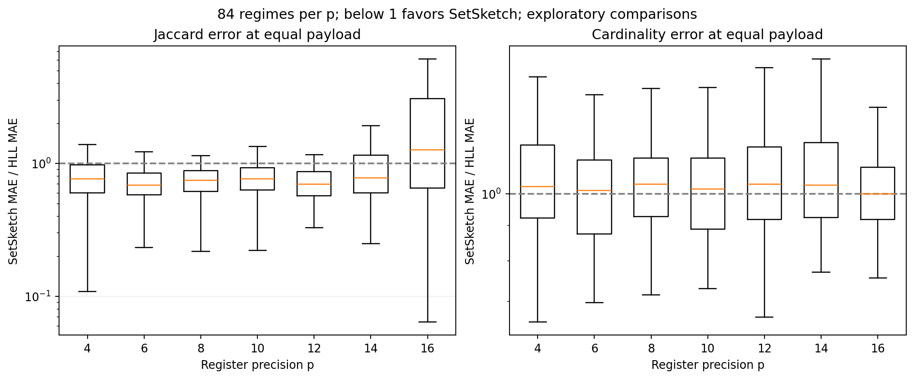

# RabbitSketch2：完整 synthetic-set pilot 深入分析

实验与自动分析于北京时间 **2026-10-01 00:15:32** 完成，总耗时 125.4 分钟，其中测量约 124.1 分钟，自动分析及出图约 73 秒。

90,720/90,720 次测量完成，108 个批次均正常退出；7 个候选、54 个原生配置、84 个可行数据场景，每个配置/场景 20 次配对重复。MinHash 即当前 FastKMV；OrderMinHash 按用户要求不在实验和后续推荐范围内。

**预注册结论：目前没有算法达到淘汰门槛。** 以下统一预算、相对误差和参数覆盖分析均为事后诊断，不修改原始筛选阈值，也不把事后排名作为已验证的推荐边界。

## 1. 前沿与淘汰证据

| 算法 | 四维前沿场景 /84 | 误差–字节前沿场景 /84 | 稳健支配场景 /84 | 空采样次数 |
|---|---:|---:|---:|---:|
| MinHash | 30 | 11 | 7 | 0 |
| FracMinHash | 82 | 53 | 0 | 346 |
| HLL | 84 | 52 | 0 | 0 |
| SetSketch | 84 | 84 | 0 | 0 |
| KSSD | 84 | 84 | 0 | 74 |
| ProbMinHash (unweighted) | 15 | 5 | 19 | 0 |
| BinDash | 84 | 72 | 0 | 0 |

四维前沿使用 MAE、成对 payload、构建时间和查询时间；“进入某场景前沿”表示该算法至少一个配置进入。稳健支配仍使用原协议的配对 bootstrap、实际资源增益与全部配置条件。不能用配置级支配比例替代算法级淘汰条件。

KSSD 的 `drlevel=0` 在全部 84 个场景中得到零误差，其最大成对 payload 为 160 MB。这一全量保留配置解释了 KSSD 的 84/84 前沿覆盖；仅看 `drlevel>0`，它仍在 54/84 个场景进入误差–字节前沿。

MinHash 与 unweighted ProbMinHash 的前沿覆盖较少，值得继续验证冗余假设；但当前证据不满足预注册的 ≥90% 场景要求，不能宣布淘汰。

## 2. 按真实 payload 预算比较

预算为 A+B 两个 sketch 的总 payload，不是单个 sketch，也不含对象/缓存/构建临时内存。每个算法/场景选取在 20 次重复中**最大观测 payload 均不超过预算**、且平均 payload 最大的配置；选参不读取估计误差。这个观测上限不保证未来样本也满足同一内存上限。

2、8、32 KiB 是本轮固定大小算法共同覆盖较完整的预算点：BinDash、MinHash、ProbMinHash、HLL、SetSketch 均有对应原生分辨率；短集合可能提前饱和。

| 成对预算 | BinDash MAE 更低的场景 /84 | BinDash/MinHash MAE 比值中位数 | 配对 95% 区间完全低于 0 的场景 |
|---|---:|---:|---:|
| 2 KiB | 84/84 | 0.509 | 59/84 |
| 8 KiB | 84/84 | 0.484 | 64/84 |
| 32 KiB | 84/84 | 0.490 | 71/84 |

这些配对区间是在单个已观测配置对上的探索性结果，未做多重比较校正；场景间也不等同于独立生物学样本。现阶段可以把 BinDash 作为紧凑 Jaccard 比较的重点验证候选，还不能据此宣布所有真实基因组任务的赢家。

**参数覆盖会影响排名。** HLL/SetSketch 只扫了偶数 p，因此在 1、4、16、64 KiB 等预算下经常只用掉一半预算；BinDash 本轮最多 16,384 bins，即成对 64 KiB。128/256 KiB 下 BinDash 排名变化可能来自测试上限，不能解释为真实算法切换边界。KSSD 的 reduction 网格也很粗。完整的预算利用率见 `budget_coverage.csv`。

## 3. 低 Jaccard 需要额外检查分辨能力

当真实 J=0.001 时，始终预测 0 的 MAE 就是 0.001，已满足绝对误差阈值 0.005 或 0.01。因此原始 query-reuse 表中的“最快且满足误差阈值”并不一定能分辨低相似度样本。

补充诊断使用 `MAE 的 95% 上界 / J <= 25%`；`relative_guarded_reuse.csv` 进一步要求该上界同时 <=0.005。这是事后敏感性分析，保留原始绝对误差分析及淘汰规则。没有配置满足时明确标记不可行。

| 成对预算 | MinHash 达标场景 /84 | BinDash 达标场景 /84 | SetSketch 达标场景 /84 |
|---|---:|---:|---:|
| 2 KiB | 27 | 47 | 49 |
| 8 KiB | 47 | 62 | 54 |
| 32 KiB | 62 | 66 | 55 |

## 4. HLL 与 SetSketch 的相同精度参数对照

相同 p、相同 payload 下，p=4–14 的 504 项配置/场景对照中，SetSketch 有 414 项 Jaccard MAE 更低；p=16 时为 40/84。趋势随精度变化，因此不能概括成一方全面支配另一方。

p=16 的反转集中在较小集合：较大集合基数为 10^5、10^6、10^7 时，SetSketch 的 Jaccard MAE 更低的场景分别为 6/28、7/28、27/28。这需要按当前实现的估计器适用范围核查，不能直接解释为 SetSketch 范式的固有劣势。

基数误差采用每次重复中 A、B 两侧相对绝对误差的平均值。全部同 p 对照中，SetSketch/HLL 基数 MAE 比值的中位数为 1.020。独立的基数角色仍需要保留；本轮 Jaccard 筛选不能移除该角色。

### SetSketch 小集合异常的独立复现

使用原来的 main 入口、64 线程、相同输入种子及原生库，给冻结 worker 的副本增加诊断输出。p=12/14/16 各复现 20 个原始 pair，全部默认估计值、输入摘要和 payload 与原记录完全一致。诊断调用改变了查询顺序，因此这些新耗时不参与性能统计。

固定 k=20、|A|=10,000、|B|=100,000，真实 J=0.001001001。

| p | 默认 J 估计均值 | 默认估计器 MAE | 实例 inclusion–exclusion MAE | 双方均空的寄存器比例 |
|---|---:|---:|---:|---:|
| 12 | 0.0020056878 | 0.0019425406 | 0.0055287719 | 0.00% |
| 14 | 1.0013561e-09 | 0.001001 | 0.0024851169 | 0.13% |
| 16 | 0.055715509 | 0.054714508 | 0.0006740214 | 18.90% |

p=16 时默认估计器的 MAE 为 0.054715，现有实例 inclusion–exclusion 路径为 0.000674；说明该异常与默认查询路径有关，不能简单归咎于寄存器容量不足。p=12/14 下 inclusion–exclusion 又不占优，因而不能未经验证就全局替换估计器。

源码核查：当前基数估计已使用 partitioned register 的边际似然；默认 joint 内核仍基于寄存器相等/大于/小于计数，并在双方均空或饱和的寄存器超过 30% 时回退。本例双方均空比例约 18.9%，20 次均未触发回退。这支持“低负载区间的 joint 模型或回退策略需要修正”的假设；尚未完成修复验证。

不能仅把 30% 阈值调低：单独诊断现有静态 `jaccardFromCores` 路径时，p=16 的 MAE 为 2.037，输出还可能超出 [0,1]。该静态路径用 `factor/sum` 计算 union，与实例路径的基数处理不同。它在这组原始测量中并未实际触发；原始 Jaccard 估计仍全部位于 [0,1]。

定位：[joint 内核](../../../results/README.md#external-archive)，[实例 inclusion–exclusion](../../../results/README.md#external-archive)，[静态 fallback](../../../results/README.md#external-archive)。

复现入口：`benchmarks/screening/diagnose_setsketch.py`；完整输出与编译/链接摘要在 `setsketch_diagnostic/`。原生库、原始记录和预注册结论均保留。

## 5. 空采样与大小不平衡

420 次测量有一侧或两侧采样为空，其中 FracMinHash 346 次、KSSD 74 次。对应 62 个配置/场景已按原协议排除出前沿；空采样不是进程失败。它们集中在小集合与较强 reduction/scaled 配置。

对 FracMinHash，小集合的预期样本数约为 `|A|/scaled`。例如 |A|=1000、scaled=10000 时仅为 0.1；预算选择需要检查小集合保留的样本数，不能只看大集合大小。这一轮测量的是 Jaccard，尚未测 directed containment，不能从本轮给出 containment 的算法切换阈值。

## 6. 性能结果的适用范围

构建和查询耗时来自一个 main 进程的 64 线程样本列表负载；每个线程测量一个 pair。总批次时间包含合成集合生成、N 分隔序列构造、哈希、sketch 构建和重复查询。批次吞吐量不等于纯 genome 构建吞吐量，也不等于 all-vs-all 查询吞吐量。

RSS 是整个共享进程的高水位，包含所有并行输入和分配器保留。KSSD 进程的最大值约 140.3 GiB；它不能充当某一个 sketch 的内存占用。字节预算只使用实测 finalized query-array payload。

## 7. 下一轮应验证的内容

1. 优先核查 SetSketch 低负载 joint 估计器与静态 fallback；用小、中、大集合及不同 p 验证任何修复，为修复版本建立独立结果，避免与当前快照混合。
2. 在预先指定的 2/8/32 KiB 成对预算下，对真实基因组的精确 canonical k-mer Jaccard 做独立验证，重点复核 BinDash、当前 MinHash 与 unweighted ProbMinHash 的差异。七个候选仍保留在注册初筛结果中。
3. 补齐预算网格：HLL/SetSketch 加入所需奇数 p；如考察 128/256 KiB，扩展 BinDash bins，并核对其他算法的预算覆盖，再生成推荐边界。
4. 单独开展 directed containment 与 abundance 实验；HLL/SetSketch 的 cardinality 角色独立评估。OrderMinHash 和专门的顺序实验已排除。
5. 在完成生物学验证后，再对保留方法测量真实 FASTA 构建、重复查询和 all-vs-all 系统性能。

## 可复现文件

- 原始完成实验（只读）：`/home/bigssd/zt/rabbitsketch2_benchmark/runs/pilot`。
- `followup_manifest.json`：输入 SHA-256、原始行摘要核验、脚本版本和补充分析规则。
- `algorithm_summary.csv`：预注册前沿、空采样与淘汰状态。
- `budget_selected_configurations.csv`、`budget_coverage.csv`：按 payload 选参及覆盖。
- `paired_budget_comparisons.csv`：与 MinHash 的配对误差对照及区间。
- `hll_setsketch_comparisons.csv`：相同 p/相同 payload 的 Jaccard 和 cardinality 对照。
- `relative_guarded_reuse.csv`：补充相对精度条件下的查询复用选择。
- `empty_sampling.csv`：空采样配置/场景明细。
- 所有图同时保存 PNG 和独立 PDF，可供审阅和导出。
